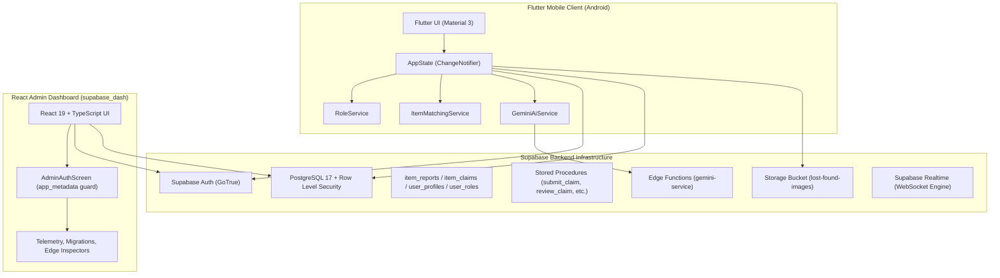
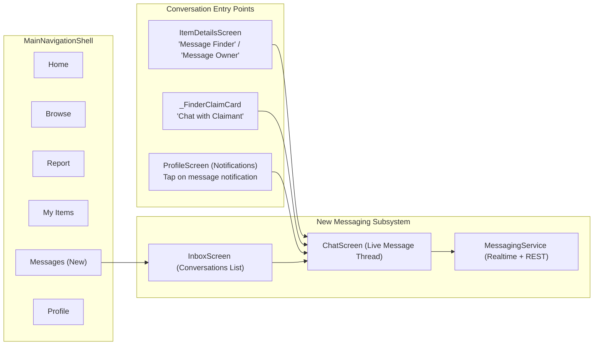
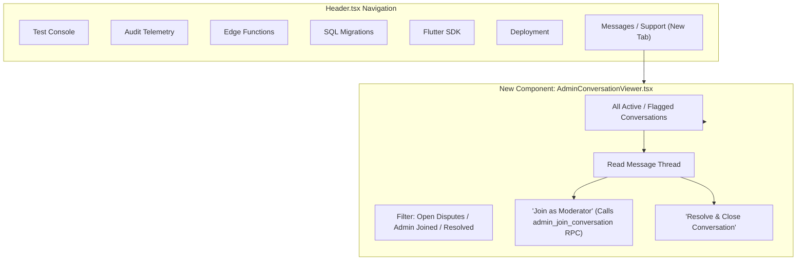
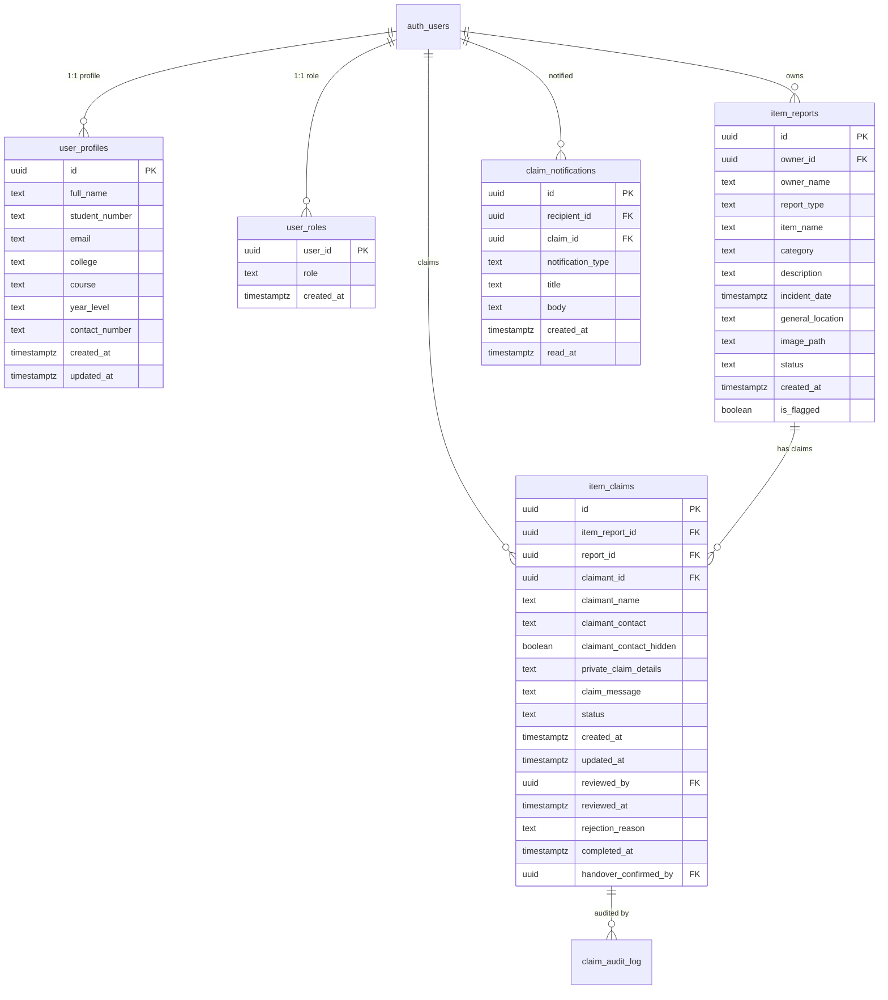
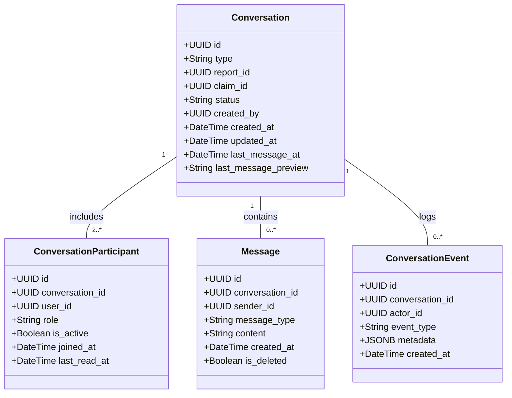
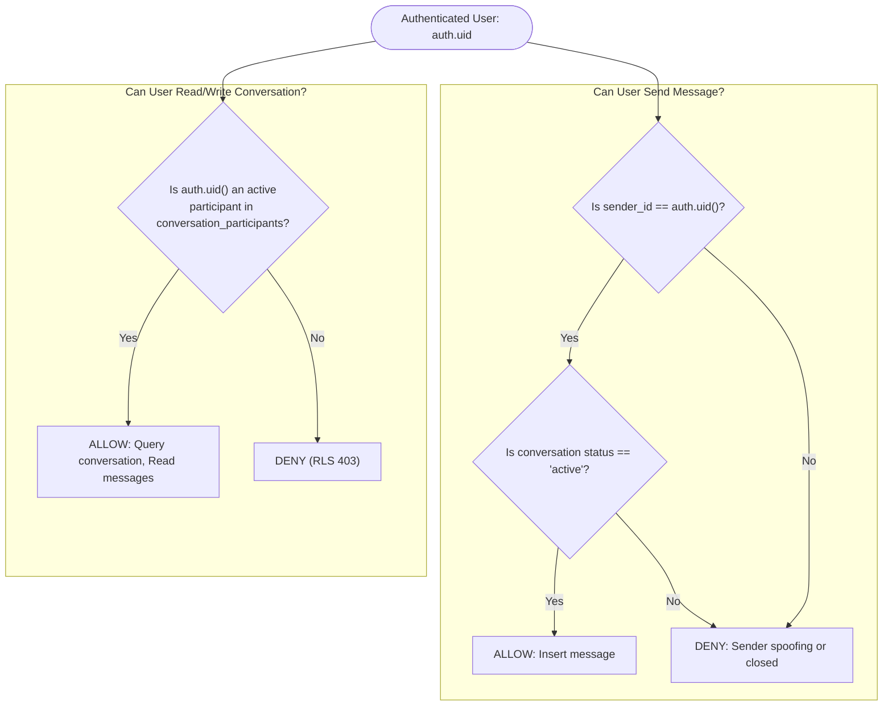
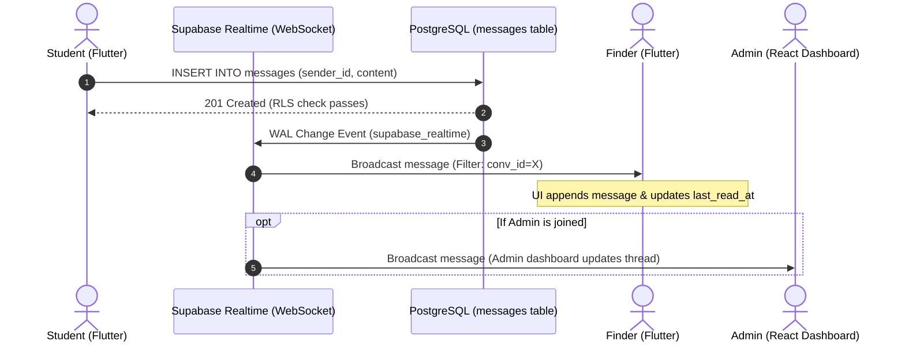
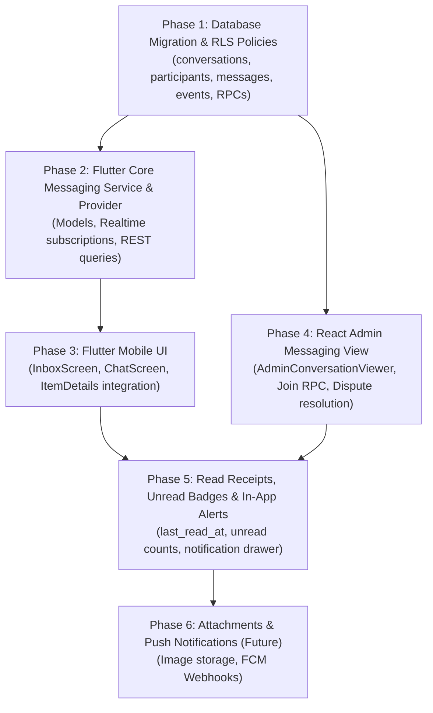

# MarSU Lost & Found – Private Messaging Architecture Inspection & Implementation Plan

> **Document Status**: COMPLETED INSPECTION REPORT  
> **Inspection Date**: November 2026  
> **Target Project**: MarSU Lost & Found Application  
> **Inspection Scope**: Flutter (Android Student App), React + TypeScript (Admin Dashboard), Supabase (Auth, PostgreSQL, Storage, RLS, Realtime)  
> **Rule Adherence**: Inspection only. No application code, database schema, or configuration files have been altered.

---

## 1. Existing Project Architecture

The MarSU Lost & Found platform is a multi-tier campus application consisting of a mobile client, a web-based administrative dashboard, and a Supabase backend:



### 1.1 Flutter Application (`marsu_lost_and_found`)
- **SDK & Framework**: Flutter (Dart `^3.13.4`), targeting Android mobile students.
- **State Management**: `provider: ^6.1.5+1`. A single global `AppState` (inheriting from `ChangeNotifier`) is mounted at the root in `lib/main.dart` and provides data and mutations across screens via `context.watch<AppState>()` and `context.read<AppState>()`.
- **Backend SDK**: `supabase_flutter: ^2.18.3`. Firebase packages (`firebase_core`, `cloud_firestore`, `firebase_auth`, `firebase_storage`) are imported and initialized in `main.dart`, but all live application data flows through Supabase.
- **Directory Layout**:
  - `lib/core/`: Application constants (`app_colors.dart`), themes (`app_theme.dart`), and account validation helpers (`account_validators.dart`).
  - `lib/models/`: Strongly-typed entities:
    - `user_model.dart`: Campus user profile and parsed roles.
    - `item_report_model.dart`: Lost and found item records with enums `ReportType` and `ItemStatus`.
    - `claim_model.dart`: Ownership claims with status lifecycle.
    - `claim_notification_model.dart`: In-app notification data.
    - `claim_audit_model.dart`: Admin audit log entries.
  - `lib/providers/`: `app_state.dart` containing session lifecycle, profile fetching/syncing, report submission, claim submission via RPC, image uploading, and admin operations.
  - `lib/screens/`: Screen widgets organized by domain:
    - `main_navigation_shell.dart`: Persistent bottom navigation.
    - `home/home_screen.dart`: Overview and report shortcuts.
    - `browse/browse_screen.dart`: Search and category filter.
    - `report/report_item_screen.dart`: Multi-field item submission.
    - `my_reports/my_reports_screen.dart`: Filtered view of user's reported items and matched pairs.
    - `item_details/item_details_screen.dart`: Comprehensive item view, incoming claims view, and claim submission dialog trigger.
    - `profile/profile_screen.dart`: Account summary, notification drawer, edit profile navigation, and admin/moderator panel access.
    - `admin/admin_screen.dart`: Moderation panel for claim approvals/rejections, role management, and audit log inspection.
    - `auth/login_screen.dart`: Authentication interface for student login and registration.
    - `developer/gemini_test_screen.dart`: Diagnostics screen for testing Gemini Edge Function integration.
  - `lib/services/`:
    - `role_service.dart`: Encapsulates role fetching and assignment RPC calls.
    - `item_matching_service.dart`: Heuristic keyword matching between lost and found items.
    - `gemini_ai_service.dart`: Invokes Supabase Edge Functions for AI matching and chat.
  - `lib/widgets/`: Modular UI widgets (`item_status_badges.dart`, `claim_submission_dialog.dart`, `possible_matches_section.dart`, `animated_reveal.dart`).

### 1.2 React Admin Dashboard (`supabase_dash`)
- **Technology Stack**: React 19, TypeScript, Vite, Tailwind CSS v4, Lucide React, Express server simulator (`server.ts`).
- **Location**: Located in sibling directory `D:\FlutterProjects\supabase_dash`.
- **Client Configuration**: `src/lib/supabase.ts` instantiates `@supabase/supabase-js: ^2.119.0` using environment variables `VITE_SUPABASE_URL` and `VITE_SUPABASE_PUBLISHABLE_KEY`.
- **Navigation & Layout**: Tab-driven SPA in `App.tsx` governed by `activeTab: NavTab`:
  - `tester`: Gemini prompt diagnostics (`PromptTester.tsx`).
  - `logs`: AI telemetry audit viewer (`AuditLogViewer.tsx`).
  - `edge-functions`: Edge function inspection (`EdgeFunctionInspector.tsx`).
  - `migrations`: Migration status and SQL scripts (`MigrationViewer.tsx`).
  - `flutter-sdk`: Code snippets and SDK alignment (`FlutterServiceViewer.tsx`).
  - `deployment`: Production deployment guide (`DeploymentGuide.tsx`).
- **Authentication Guard**: `isAdminSession()` validates that `session?.user.app_metadata?.role === 'admin'`. Non-admin sessions render `AdminAuthScreen` in 'denied' mode.

### 1.3 Supabase Backend
- **PostgreSQL Database**: PostgreSQL 17 engine with RLS active on all public application tables.
- **Storage**: Private bucket `lost-found-images` secured with user-folder RLS.
- **Edge Functions**: `supabase/functions/gemini-service` (Deno runtime) acting as a secure gateway to Gemini AI with strict JWT verification (`authValidator.ts`).
- **Realtime Engine**: Supabase Realtime daemon enabled in `config.toml`.

---

## 2. Flutter Integration Points



### 2.1 Main Navigation (`lib/screens/main_navigation_shell.dart`)
- **Current State**: `MainNavigationShell` manages 5 navigation destinations via `NavigationBar`: Home (0), Browse (1), Report (2), My Items (3), Profile (4).
- **Integration Options**:
  - **Option A (Recommended)**: Insert a 5th tab for "Inbox" / "Messages" with a real-time unread badge, shifting "Profile" to index 5 (6 tabs total), or replacing "Report" with an action button and having 5 standard tabs.
  - **Option B**: Add an action icon in the global `AppBar` of `HomeScreen` and `ProfileScreen` with an unread badge that pushes `InboxScreen` via standard `Navigator.push`.
- **Verdict**: Option A provides the most accessible user experience for active communication between lost and found parties.

### 2.2 Item Details Screen (`lib/screens/item_details/item_details_screen.dart`)
- **Context**: Screen where a user views an item report, verifies details, submits a claim, or reviews incoming claims.
- **Integration Point 1 (Claimant to Finder)**: When viewing a found item (`reportType == found`) that is not owned by the viewer, add a secondary action: `"Message Finder"`.
  - Condition: If a claim already exists between viewer and item, open or resume the linked conversation.
- **Integration Point 2 (Finder to Claimant)**: In `_IncomingClaimsSection` -> `_FinderClaimCard`:
  - When the finder reviews incoming claims from students, add an action button: `"Message Claimant"`.
  - Enables direct inquiry into private marks before confirming handover.
- **Integration Point 3 (Moderator/Admin Assistance)**: When a claim is disputed or flagged, add `"Request Moderator Assistance"`, which invites an administrator to the conversation.

### 2.3 Notification System (`lib/screens/profile/profile_screen.dart`)
- **Current State**: Notifications from `public.claim_notifications` are displayed in an `ExpansionTile` on `ProfileScreen`.
- **Integration Point**: Tapping a message notification should navigate directly to `ChatScreen(conversationId: notification.conversationId)`.

### 2.4 State Management (`lib/providers/app_state.dart`)
- **Current State**: Holds `_currentUser`, `_items`, `_claims`, `_notifications`, `_roleAssignments`.
- **Safest Approach**: Do NOT bloat `AppState` with message arrays and active WebSocket subscriptions. Instead:
  - Create an independent `MessagingService` or a separate `MessagingProvider`.
  - Let `MessagingProvider` depend on `AppState.currentUser.id` for initialization.
  - Expose unread message counters so `MainNavigationShell` can show badge indicators.

---

## 3. React Dashboard Integration Points



### 3.1 Routing and Tab Architecture (`src/types/index.ts` & `src/App.tsx`)
- **Current State**: SPA navigation uses type `NavTab = 'tester' | 'logs' | 'edge-functions' | 'migrations' | 'flutter-sdk' | 'deployment'`.
- **Integration Point**:
  1. Add `'conversations'` to `NavTab` in `src/types/index.ts`.
  2. Add a navigation button in `src/components/Header.tsx`.
  3. Render `<AdminConversationViewer />` when `activeTab === 'conversations'`.

### 3.2 Security and Role Verification
- **Current State**: `App.tsx` strictly verifies `session.user.app_metadata?.role === 'admin'`.
- **Integration Invariant**: Admins in `supabase_dash` must never silently lurk in conversations. The dashboard must only allow reading messages if:
  1. The administrator explicitly clicks `"Join Conversation"`.
  2. The server-side RPC `admin_join_conversation` executes, inserting the admin into `conversation_participants` and posting a visible system event (`admin_joined`).

### 3.3 Conflict Avoidance
- Existing tabs (`AuditLogViewer`, `PromptTester`, `MigrationViewer`) operate independently on separate Supabase endpoints. Adding the messaging tab introduces zero regression risk to existing views.

---

## 4. Existing Supabase Database Schema

All database structures were inspected directly from the repository SQL migration files.



### 4.1 Verified Table Specifications

#### Table: `public.item_reports`
- **Source**: `supabase_schema.sql`
- **Columns**:
  - `id`: `uuid` (Primary Key, default `gen_random_uuid()`)
  - `owner_id`: `uuid` (Foreign Key -> `auth.users(id)` ON DELETE CASCADE)
  - `owner_name`: `text` (Display name of reporting student)
  - `report_type`: `text` (`CHECK (report_type IN ('lost', 'found'))`)
  - `item_name`: `text`
  - `category`: `text`
  - `description`: `text`
  - `incident_date`: `timestamptz`
  - `general_location`: `text`
  - `image_path`: `text` (Nullable, points to object in storage)
  - `status`: `text` (`CHECK (status IN ('open', 'claimPending', 'returned', 'closed'))`, default `'open'`)
  - `created_at`: `timestamptz` (default `now()`)
  - `is_flagged`: `boolean` (default `false`)
- **RLS**: Enabled. SELECT is public to authenticated users; INSERT/UPDATE restricted to report owner; UPDATE for moderation granted to admins.

#### Table: `public.user_profiles`
- **Source**: `supabase_user_profiles_migration.sql`
- **Table Name Verification**: Confirmed as `user_profiles` (NOT `usr_profiles`).
- **Columns**:
  - `id`: `uuid` (Primary Key, Foreign Key -> `auth.users(id)` ON DELETE CASCADE)
  - `full_name`: `text`
  - `student_number`: `text`
  - `email`: `text`
  - `college`: `text`
  - `course`: `text`
  - `year_level`: `text`
  - `contact_number`: `text`
  - `created_at`: `timestamptz`
  - `updated_at`: `timestamptz`
- **Unique Indexes**: `user_profiles_student_number_unique` on `LOWER(TRIM(student_number))` where `student_number <> ''`.
- **Triggers**:
  - `user_profiles_set_updated_at`: Sets `updated_at = now()`.
  - `user_profiles_prevent_student_number_change`: Disallows mutating student number once set.
  - `on_auth_user_created_profile`: Auto-populates profile from `auth.users` on signup.
- **RLS**: Enabled. Users can only SELECT, INSERT, and UPDATE their own record (`id = auth.uid()`).

#### Table: `public.user_roles`
- **Source**: `supabase_rbac_migration.sql`
- **Columns**:
  - `user_id`: `uuid` (Primary Key, Foreign Key -> `auth.users(id)` ON DELETE CASCADE)
  - `role`: `text` (`CHECK (role IN ('student', 'moderator', 'admin'))`, default `'student'`)
  - `created_at`: `timestamptz`
- **Stored Functions**:
  - `public.current_user_role() RETURNS text`: Returns role of current caller or `'student'`.
  - `public.has_role(required_role text) RETURNS boolean`: Helper for RLS.
  - `public.set_user_role(target_user_id uuid, target_role text)`: Admin-only role assignment RPC.
  - `public.list_user_roles()`: Admin-only user role listing RPC.
- **RLS**: Enabled. Users can only SELECT their own role.

#### Table: `public.item_claims`
- **Source**: `supabase_claim_rls_fix.sql` & `supabase_claim_workflow_migration.sql`
- **Columns**:
  - `id`: `uuid` (Primary Key, default `gen_random_uuid()`)
  - `item_report_id`: `uuid` (Foreign Key -> `public.item_reports(id)` ON DELETE CASCADE)
  - `report_id`: `uuid` (Foreign Key -> `public.item_reports(id)` ON DELETE CASCADE)
  - `claimant_id`: `uuid` (Foreign Key -> `auth.users(id)` ON DELETE CASCADE)
  - `claimant_name`: `text`
  - `claimant_contact`: `text`
  - `claimant_contact_hidden`: `boolean` (default `true`)
  - `private_claim_details`: `text` (Secret proof of ownership)
  - `claim_message`: `text` (Nullable)
  - `status`: `text` (`CHECK (status IN ('pending', 'approved', 'rejected', 'completed'))`, default `'pending'`)
  - `created_at`: `timestamptz` (default `now()`)
  - `updated_at`: `timestamptz` (default `now()`)
  - `reviewed_by`: `uuid` (Foreign Key -> `auth.users(id)`)
  - `reviewed_at`: `timestamptz`
  - `rejection_reason`: `text`
  - `completed_at`: `timestamptz`
  - `handover_confirmed_by`: `uuid` (Foreign Key -> `auth.users(id)`)
- **Synchronization**: Trigger `item_claims_sync_report_ids` ensures `report_id` and `item_report_id` remain identical.
- **Partial Unique Index**: `one_pending_claim_per_claimant` on `(report_id, claimant_id)` where `status = 'pending'`.
- **RLS & Security Invariant**: Direct client INSERT is revoked. Claims must be submitted via RPC `submit_claim` and reviewed via RPC `review_claim`.

#### Table: `public.claim_audit_log`
- **Source**: `supabase_claim_workflow_migration.sql`
- **Columns**: `id`, `claim_id` (FK), `actor_id` (FK), `action`, `previous_status`, `new_status`, `created_at`.
- **RLS**: Enabled. Restricted to administrators (`public.has_role('admin')`).

#### Table: `public.claim_notifications`
- **Source**: `supabase_claim_workflow_migration.sql`
- **Columns**: `id`, `recipient_id` (FK), `claim_id` (FK), `notification_type`, `title`, `body`, `created_at`, `read_at`.
- **RLS**: Enabled. Users can only SELECT records where `recipient_id = auth.uid()`.

---

## 5. Verified Relationships Between Reports and Claims

1. **One-to-Many Report-to-Claim Mapping**:
   An item report of type `'found'` can have zero, one, or multiple associated claims:
   $$\text{item\_reports}(id) \xrightarrow{1:N} \text{item\_claims}(report\_id)$$
2. **One Active Claim Per User Constraint**:
   A student cannot submit multiple pending claims for the same found item (`active_claims_per_claimant` index on `(report_id, claimant_id)` where `status IN ('pending', 'approved')`).
3. **Status Cascading Rules**:
   - When a claim is submitted: `item_reports.status` transitions from `'open'` to `'claimPending'`.
   - When a claim is rejected: `item_reports.status` reverts to `'open'` unless other pending claims exist.
   - When a claim is completed: `item_reports.status` transitions to `'returned'`.
4. **Participants Involved in a Claim**:
   - **Report Owner / Finder**: `item_reports.owner_id`
   - **Claimant**: `item_claims.claimant_id`
   - **Assigned / Reviewing Admin or Moderator**: `item_claims.reviewed_by`

---

## 6. Existing Authentication and Role Validation

### 6.1 Authentication Mechanism
- Primary authentication is handled by Supabase Auth (GoTrue).
- Sessions are token-based (JWT) containing `sub` (user UUID), `email`, `app_metadata`, and `user_metadata`.

### 6.2 The Three Role Sources in the Existing Codebase

| Component | Role Storage Source | Validation Method | Trust Level |
| :--- | :--- | :--- | :--- |
| **Database RBAC** | `public.user_roles` table | `public.has_role('admin')` SQL function | **High (Authoritative)** |
| **Edge Functions** | `user.app_metadata.role` | Validated by `authValidator.ts` | **High (Authoritative)** |
| **React Dashboard** | `user.app_metadata.role` | Evaluated in `isAdminSession()` | **High (Authoritative)** |
| **Flutter AppState** | `public.user_roles` via RPC | Fallback to `user.user_metadata` in constructor | **Requires Care** |

### 6.3 Security Invariants
- **NEVER trust `user_metadata` for authorization**: In Supabase, end-users can edit their own `user_metadata` via `supabase.auth.updateUser()`. Any authorization checks using `user_metadata` are vulnerable to privilege escalation.
- **Authoritative Source**: In PostgreSQL RLS and security-definer RPCs, role checks MUST exclusively use `public.user_roles` via `public.has_role('admin' | 'moderator')` or `auth.jwt() -> 'app_metadata' ->> 'role'`.

---

## 7. Existing RLS Policies Relevant to Messaging

### 7.1 Existing Policies on Tables Interfacing with Messaging
1. **`item_reports`**:
   - `Authenticated users can view reports`: Allows any signed-in student to view item cards.
   - `Users can create their own reports`: Enforces `owner_id = auth.uid()`.
2. **`item_claims`**:
   - `Claimants owners and moderators can view claims`:
     ```sql
     claimant_id = (SELECT auth.uid())
     OR EXISTS (
       SELECT 1 FROM public.item_reports r
       WHERE r.id = report_id AND r.owner_id = (SELECT auth.uid())
     )
     OR public.has_role('admin')
     OR public.has_role('moderator')
     ```
   - Direct INSERT is disabled.
3. **`user_profiles`**:
   - Restricted to `id = auth.uid()`.
   - **Crucial Finding**: Users cannot query other users' profiles directly via `user_profiles`. When a conversation is opened, displaying the recipient's name requires a secure public projection or a helper function (e.g., `get_public_profile(user_id)`).

---

## 8. Proposed Messaging Architecture



### 8.1 Conversation Scenarios

#### Scenario 1: One-to-One Report Inquiries (Finder $\leftrightarrow$ Inquirer / Loser)
- User finds an item or notices a lost item report.
- Initiates a direct conversation linked to `report_id`.
- Two participants: Reporter (`participant`) and Inquirer (`participant`).

#### Scenario 2: Claim Verification (Finder $\leftrightarrow$ Claimant)
- Created upon claim submission or when the finder initiates contact regarding a specific claim.
- Linked to both `report_id` and `claim_id`.
- Protects claimant privacy: claimant contact remains hidden, but messaging allows safe question-and-answer verification.

#### Scenario 3: Admin / Moderator Assistance
- Either party can tap `"Request Staff Assistance"` if there is a dispute or safety concern.
- An authorized administrator reviews the conversation metadata and joins via `admin_join_conversation(conversation_id)`.
- The system immediately:
  1. Inserts the administrator into `conversation_participants` (`role = 'admin'`).
  2. Emits a system message: `"Admin [Name] joined the conversation"`.
  3. Inserts a `conversation_events` audit row (`event_type = 'admin_joined'`).
  4. Preserves all past messages for the incoming admin while alerting the students.
  5. Prohibits any silent monitoring.

---

## 9. Proposed Database Schema

> **Notice**: The following schema is proposed for future implementation. No tables or scripts have been executed.

```sql
-- 1. Conversation container
CREATE TABLE public.conversations (
    id UUID PRIMARY KEY DEFAULT gen_random_uuid(),
    conversation_type TEXT NOT NULL DEFAULT 'direct'
        CHECK (conversation_type IN ('direct', 'group')),
    report_id UUID REFERENCES public.item_reports(id) ON DELETE SET NULL,
    claim_id UUID REFERENCES public.item_claims(id) ON DELETE SET NULL,
    status TEXT NOT NULL DEFAULT 'active'
        CHECK (status IN ('active', 'resolved', 'closed', 'archived')),
    created_by UUID NOT NULL REFERENCES auth.users(id),
    created_at TIMESTAMPTZ NOT NULL DEFAULT now(),
    updated_at TIMESTAMPTZ NOT NULL DEFAULT now(),
    last_message_at TIMESTAMPTZ NOT NULL DEFAULT now(),
    last_message_preview TEXT NOT NULL DEFAULT ''
);

CREATE INDEX idx_conversations_report_id ON public.conversations(report_id);
CREATE INDEX idx_conversations_claim_id ON public.conversations(claim_id);
CREATE INDEX idx_conversations_status ON public.conversations(status);
CREATE INDEX idx_conversations_last_message_at ON public.conversations(last_message_at DESC);

-- 2. Participants membership
CREATE TABLE public.conversation_participants (
    id UUID PRIMARY KEY DEFAULT gen_random_uuid(),
    conversation_id UUID NOT NULL REFERENCES public.conversations(id) ON DELETE CASCADE,
    user_id UUID NOT NULL REFERENCES auth.users(id) ON DELETE CASCADE,
    role TEXT NOT NULL DEFAULT 'participant'
        CHECK (role IN ('participant', 'moderator', 'admin')),
    is_active BOOLEAN NOT NULL DEFAULT true,
    joined_at TIMESTAMPTZ NOT NULL DEFAULT now(),
    last_read_at TIMESTAMPTZ NOT NULL DEFAULT now(),
    CONSTRAINT uq_conversation_participant UNIQUE (conversation_id, user_id)
);

CREATE INDEX idx_conv_participants_user_id ON public.conversation_participants(user_id, is_active);
CREATE INDEX idx_conv_participants_conv_id ON public.conversation_participants(conversation_id);

-- 3. Messages log
CREATE TABLE public.messages (
    id UUID PRIMARY KEY DEFAULT gen_random_uuid(),
    conversation_id UUID NOT NULL REFERENCES public.conversations(id) ON DELETE CASCADE,
    sender_id UUID NOT NULL REFERENCES auth.users(id) ON DELETE CASCADE,
    message_type TEXT NOT NULL DEFAULT 'text'
        CHECK (message_type IN ('text', 'system', 'event')),
    content TEXT NOT NULL CHECK (length(trim(content)) > 0 AND length(content) <= 4000),
    is_deleted BOOLEAN NOT NULL DEFAULT false,
    deleted_at TIMESTAMPTZ,
    created_at TIMESTAMPTZ NOT NULL DEFAULT now()
);

CREATE INDEX idx_messages_conv_created ON public.messages(conversation_id, created_at ASC);
CREATE INDEX idx_messages_sender ON public.messages(sender_id);

-- 4. Audit & Lifecycle events
CREATE TABLE public.conversation_events (
    id UUID PRIMARY KEY DEFAULT gen_random_uuid(),
    conversation_id UUID NOT NULL REFERENCES public.conversations(id) ON DELETE CASCADE,
    actor_id UUID NOT NULL REFERENCES auth.users(id),
    event_type TEXT NOT NULL
        CHECK (event_type IN ('created', 'participant_joined', 'participant_left', 'admin_joined', 'resolved', 'closed')),
    metadata JSONB NOT NULL DEFAULT '{}'::jsonb,
    created_at TIMESTAMPTZ NOT NULL DEFAULT now()
);

CREATE INDEX idx_conv_events_conv ON public.conversation_events(conversation_id, created_at DESC);

-- 5. Message attachments (Planned Phase 6)
-- Schema defined for future evaluation:
-- CREATE TABLE public.message_attachments (
--     id UUID PRIMARY KEY DEFAULT gen_random_uuid(),
--     message_id UUID NOT NULL REFERENCES public.messages(id) ON DELETE CASCADE,
--     storage_path TEXT NOT NULL,
--     file_type TEXT NOT NULL,
--     file_size_bytes INTEGER NOT NULL,
--     created_at TIMESTAMPTZ NOT NULL DEFAULT now()
-- );
```

---

## 10. Proposed RLS and Authorization Design



### 10.1 Conversations Table Policies
```sql
ALTER TABLE public.conversations ENABLE ROW LEVEL SECURITY;

-- SELECT: Only active participants can see the conversation
CREATE POLICY "Participants can view their conversations"
ON public.conversations FOR SELECT TO authenticated
USING (
    EXISTS (
        SELECT 1 FROM public.conversation_participants cp
        WHERE cp.conversation_id = id
          AND cp.user_id = auth.uid()
          AND cp.is_active = true
    )
);

-- UPDATE: Participants can update resolution status if they are the report owner, or an admin
CREATE POLICY "Authorized members can update conversation status"
ON public.conversations FOR UPDATE TO authenticated
USING (
    EXISTS (
        SELECT 1 FROM public.conversation_participants cp
        WHERE cp.conversation_id = id
          AND cp.user_id = auth.uid()
          AND cp.is_active = true
    )
)
WITH CHECK (
    EXISTS (
        SELECT 1 FROM public.conversation_participants cp
        WHERE cp.conversation_id = id
          AND cp.user_id = auth.uid()
          AND cp.is_active = true
    )
);
```

### 10.2 Conversation Participants Policies
```sql
ALTER TABLE public.conversation_participants ENABLE ROW LEVEL SECURITY;

-- SELECT: Participants can see who else is in their conversations
CREATE POLICY "Participants can view members of their conversations"
ON public.conversation_participants FOR SELECT TO authenticated
USING (
    EXISTS (
        SELECT 1 FROM public.conversation_participants cp
        WHERE cp.conversation_id = conversation_id
          AND cp.user_id = auth.uid()
          AND cp.is_active = true
    )
);

-- UPDATE: Users can update their own last_read_at timestamp
CREATE POLICY "Users can update their own read timestamp"
ON public.conversation_participants FOR UPDATE TO authenticated
USING (user_id = auth.uid())
WITH CHECK (user_id = auth.uid());
```

### 10.3 Messages Policies
```sql
ALTER TABLE public.messages ENABLE ROW LEVEL SECURITY;

-- SELECT: A user can read messages ONLY if they are an active participant
CREATE POLICY "Participants can read messages"
ON public.messages FOR SELECT TO authenticated
USING (
    EXISTS (
        SELECT 1 FROM public.conversation_participants cp
        WHERE cp.conversation_id = messages.conversation_id
          AND cp.user_id = auth.uid()
          AND cp.is_active = true
    )
);

-- INSERT: Must be an active participant AND sender_id must match auth.uid() (NO SPOOFING)
CREATE POLICY "Participants can send messages"
ON public.messages FOR INSERT TO authenticated
WITH CHECK (
    sender_id = auth.uid()
    AND message_type = 'text'
    AND EXISTS (
        SELECT 1 FROM public.conversation_participants cp
        JOIN public.conversations c ON c.id = cp.conversation_id
        WHERE cp.conversation_id = messages.conversation_id
          AND cp.user_id = auth.uid()
          AND cp.is_active = true
          AND c.status = 'active'
    )
);
```

### 10.4 Server-Side Stored Procedures (Security Definers)
To enforce business rules and prevent race conditions:

1. `create_or_get_direct_conversation(p_recipient_id UUID, p_report_id UUID, p_claim_id UUID)`:
   - Validates that caller $\neq$ recipient.
   - If a conversation already exists for this pair and report/claim, returns existing ID.
   - Otherwise, inserts into `conversations`, adds both participants, and logs `'created'` event.
2. `admin_join_conversation(p_conversation_id UUID)`:
   - Verifies `public.has_role('admin') = true`.
   - Inserts admin into `conversation_participants` (`role = 'admin'`).
   - Inserts system message into `messages`: `"An administrator joined the conversation."`
   - Logs `conversation_events` with `event_type = 'admin_joined'`.
3. `close_conversation(p_conversation_id UUID, p_reason TEXT)`:
   - Validates caller is a participant or administrator.
   - Updates `conversations.status = 'resolved' | 'closed'`.
   - Inserts system message and audit log.

---

## 11. Realtime Implementation Strategy



### 11.1 PostgreSQL Publication Setup
Supabase Realtime listens to PostgreSQL WAL changes using the `supabase_realtime` publication:
```sql
ALTER PUBLICATION supabase_realtime ADD TABLE public.messages;
ALTER PUBLICATION supabase_realtime ADD TABLE public.conversations;
ALTER PUBLICATION supabase_realtime ADD TABLE public.conversation_participants;
```

### 11.2 Flutter Subscription Pattern
In Flutter `MessagingService`:
```dart
RealtimeChannel subscribeToConversation(
  String conversationId, {
  required void Function(Map<String, dynamic>) onMessage,
}) {
  return _supabase
      .channel('conversation:$conversationId')
      .onPostgresChanges(
        event: PostgresChangeEvent.insert,
        schema: 'public',
        table: 'messages',
        filter: PostgresChangeFilter(
          type: PostgresChangeFilterType.eq,
          column: 'conversation_id',
          value: conversationId,
        ),
        callback: (payload) => onMessage(payload.newRecord),
      )
      .subscribe();
}
```

### 11.3 React Dashboard Subscription Pattern
In React `AdminConversationViewer`:
```typescript
const channel = supabase
  .channel(`admin-conv:${conversationId}`)
  .on(
    'postgres_changes',
    {
      event: 'INSERT',
      schema: 'public',
      table: 'messages',
      filter: `conversation_id=eq.${conversationId}`,
    },
    (payload) => {
      appendNewMessage(payload.new);
    }
  )
  .subscribe();
```

### 11.4 Connection Lifecycle Management
- **Flutter Lifecycle**: When the Flutter app transitions to background (`AppLifecycleState.paused`), unsubscribe or pause Realtime channels to preserve mobile battery and network quota. Resubscribe on `resumed`.
- **Offline / Reconnection**: When reconnecting, fetch missing messages using `WHERE conversation_id = X AND created_at > last_fetched_timestamp`.

---

## 12. Notification Strategy

### 12.1 Phase 1 (Immediate In-App Notifications)
- When a new message is inserted, a database trigger or stored procedure inserts a record into `public.claim_notifications` (or a unified `public.in_app_notifications` table) for all other active participants in that conversation.
- The recipient's Flutter app receives the notification in their profile/inbox notification drawer and increments the unread badge.

### 12.2 Phase 2 (Mobile Push Notifications - Roadmap)
- Integrate Firebase Cloud Messaging (FCM) using the existing `firebase_core` dependency in `pubspec.yaml`.
- Trigger push notifications via a Supabase Database Webhook invoking an Edge Function:
  $$\text{PostgreSQL INSERT} \longrightarrow \text{Database Webhook} \longrightarrow \text{Edge Function (fcm-dispatcher)} \longrightarrow \text{FCM} \longrightarrow \text{Android Device}$$

---

## 13. Potential Conflicts with Existing Features

| Feature / Area | Potential Conflict | Mitigation Strategy |
| :--- | :--- | :--- |
| **Claim Review Flow** | A user might confuse messaging a finder with submitting a claim. | In `ItemDetailsScreen`, keep `"Claim This Belonging"` distinct from `"Message Finder"`. Explain that claims require formal proof verification. |
| **User Profile RLS** | Messaging displays recipient names, but `user_profiles` RLS restricts SELECT to `id = auth.uid()`. | Create a secure database function `get_public_profile(p_user_id)` returning only `full_name` and `role`, or project names into `conversation_participants`. |
| **Navigation Stack** | Adding a 6th destination in `NavigationBar` can overcrowd the mobile bottom bar. | Adopt standard 5-tab layout (Home, Browse, Messages, My Items, Profile) and place the "Report" button as a prominent FAB on Home/Browse. |
| **Gemini AI Service** | Messaging might collide with existing Gemini service models or telemetry tables. | Complete architectural separation: Private messages use `public.messages`, while AI queries use `public.ai_usage_logs` via `gemini-service`. |
| **Realtime Resource Quota** | Active WebSocket channels left open when navigating screens can consume client memory. | Cleanly call `supabase.removeChannel(channel)` in `dispose()` of Flutter State and React `useEffect()` cleanup. |

---

## 14. Recommended Implementation Phases



### Phase 1: Database Schema & RLS Setup
- Author migration `supabase_messaging_migration.sql`.
- Create tables: `conversations`, `conversation_participants`, `messages`, `conversation_events`.
- Create stored procedures: `create_or_get_direct_conversation`, `admin_join_conversation`, `close_conversation`.
- Configure `supabase_realtime` publication.

### Phase 2: Flutter Data Layer
- Author Dart models: `conversation_model.dart`, `message_model.dart`, `conversation_participant_model.dart`.
- Create `MessagingService` in `lib/services/messaging_service.dart`.
- Bind `MessagingProvider` in `lib/providers/` without bloating `AppState`.

### Phase 3: Flutter UI Screens & Entry Points
- Create `InboxScreen` with active chats and unread indicators.
- Create `ChatScreen` with message bubbles, timestamp formatting, and auto-scroll.
- Add entry points in `ItemDetailsScreen` and `_FinderClaimCard`.

### Phase 4: React Admin Dashboard Integration
- Add `'conversations'` tab to `NavTab` in `src/types/index.ts`.
- Add tab link in `Header.tsx`.
- Create `src/components/AdminConversationViewer.tsx` allowing administrators to inspect active disputes and join with full audit compliance.

### Phase 5: Verification & Polish
- Validate read receipts and unread badge synchronizations.
- Test connection recovery on mobile background/resume.
- Conduct security tests against ID guessing and impersonation.

### Phase 6 (Future Roadmap)
- Storage bucket for chat attachments (`message_attachments`).
- FCM Push notifications via Supabase Edge Function webhook.

---

## 15. Files That May Need to Be Created or Modified

### 15.1 New Files to Be Created

#### Backend / Database:
- `supabase_messaging_migration.sql`: Creates messaging tables, indexes, RLS policies, and RPCs.

#### Flutter Mobile Client:
- `lib/models/conversation_model.dart`: Conversation container entity.
- `lib/models/message_model.dart`: Message bubble entity.
- `lib/models/conversation_participant_model.dart`: Membership and read tracking.
- `lib/services/messaging_service.dart`: Supabase client integration for chat operations and Realtime streaming.
- `lib/providers/messaging_provider.dart`: State manager for active threads and unread counts.
- `lib/screens/messaging/inbox_screen.dart`: List of conversations with unread indicators.
- `lib/screens/messaging/chat_screen.dart`: Thread screen with Realtime subscription and text entry.
- `lib/widgets/message_bubble.dart`: Renders incoming, outgoing, and system messages.

#### React Admin Dashboard:
- `src/components/AdminConversationViewer.tsx`: Conversation overview and management panel for admins.

### 15.2 Existing Files to Be Modified

#### Flutter Mobile Client:
- `lib/screens/main_navigation_shell.dart`: Add Messages destination and badge.
- `lib/screens/item_details/item_details_screen.dart`: Add "Message Finder" / "Message Claimant" buttons.
- `lib/screens/profile/profile_screen.dart`: Navigate to conversations from message notifications.
- `lib/main.dart`: Register `MessagingProvider` in `MultiProvider`.

#### React Admin Dashboard:
- `src/types/index.ts`: Add `'conversations'` to `NavTab` union and define conversation types.
- `src/components/Header.tsx`: Add navigation link for "Messages".
- `src/App.tsx`: Render `AdminConversationViewer` when `'conversations'` tab is active.

---

## 16. Security Risks and Recommendations

1. **Risk: Sender Impersonation in Messages**
   - *Threat*: Malicious student crafts an API request passing someone else's `sender_id`.
   - *Mitigation*: The RLS INSERT policy strictly checks `WITH CHECK (sender_id = auth.uid())`. Attempts to insert another user's ID fail at the database level.
2. **Risk: Guessing Conversation UUIDs (Horizontal Privilege Escalation)**
   - *Threat*: An attacker loops through random UUIDs to intercept private student conversations.
   - *Mitigation*: Both `conversations` and `messages` SELECT policies enforce `EXISTS (SELECT 1 FROM conversation_participants WHERE user_id = auth.uid() AND is_active = true)`. Even if an attacker knows the exact conversation UUID, PostgREST returns an empty set (404/empty).
3. **Risk: Covert Administrator Surveillance**
   - *Threat*: Administrator silently monitors private student chats without their knowledge.
   - *Mitigation*: Admins have NO blanket SELECT policy on messages. Access is granted ONLY by joining the conversation via the `admin_join_conversation` RPC, which triggers a permanent `conversation_events` entry and broadcasts a visible system message into the chat.
4. **Risk: Cross-User Profile Leakage**
   - *Threat*: Displaying participant names in chat requires querying profiles, but `user_profiles` RLS restricts users to their own row.
   - *Mitigation*: Do not make `user_profiles` globally readable. Create a security-definer function `get_public_profile(p_user_id)` that exposes ONLY `full_name` and `role`, keeping student numbers, emails, and contact numbers private.
5. **Risk: AI Chatbot / Prompt Injection Leakage**
   - *Threat*: Private messages accidentally routed into Gemini AI service or telemetry logs.
   - *Mitigation*: Complete schema and service isolation. Gemini queries run through `gemini-service` Edge Function, while private messages remain in `public.messages`. Zero integration between private messages and AI prompt logs.

---

## 17. Unverified Information Requiring Manual Confirmation

The following elements could not be verified from the local workspace files alone and must be confirmed in the Supabase Cloud dashboard prior to deployment:

1. **Remote Realtime Publication Status**: Confirm whether the remote Supabase project (`eeedchsnxqyibprjkpdu.supabase.co`) has Realtime enabled for new tables or if `ALTER PUBLICATION supabase_realtime ADD TABLE ...` must be run manually via the SQL Editor.
2. **Remote RLS Status on `user_profiles`**: Confirm whether `user_profiles` is currently deployed with the exact columns matching `supabase_user_profiles_migration.sql`.
3. **App Metadata Role Synchronization**: Confirm whether all existing administrator accounts have `'role': 'admin'` present in `auth.users.app_metadata` in the live Supabase Auth instance, ensuring seamless login in `supabase_dash`.
4. **Firebase Configuration**: Confirm whether Firebase is intended to be phased out or retained solely for optional push notifications.
