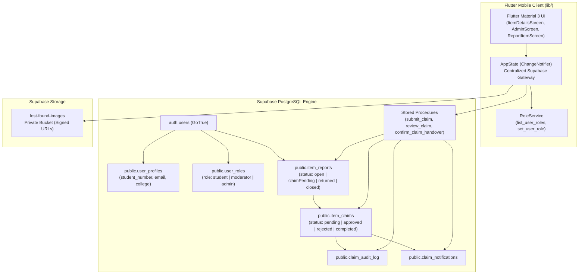
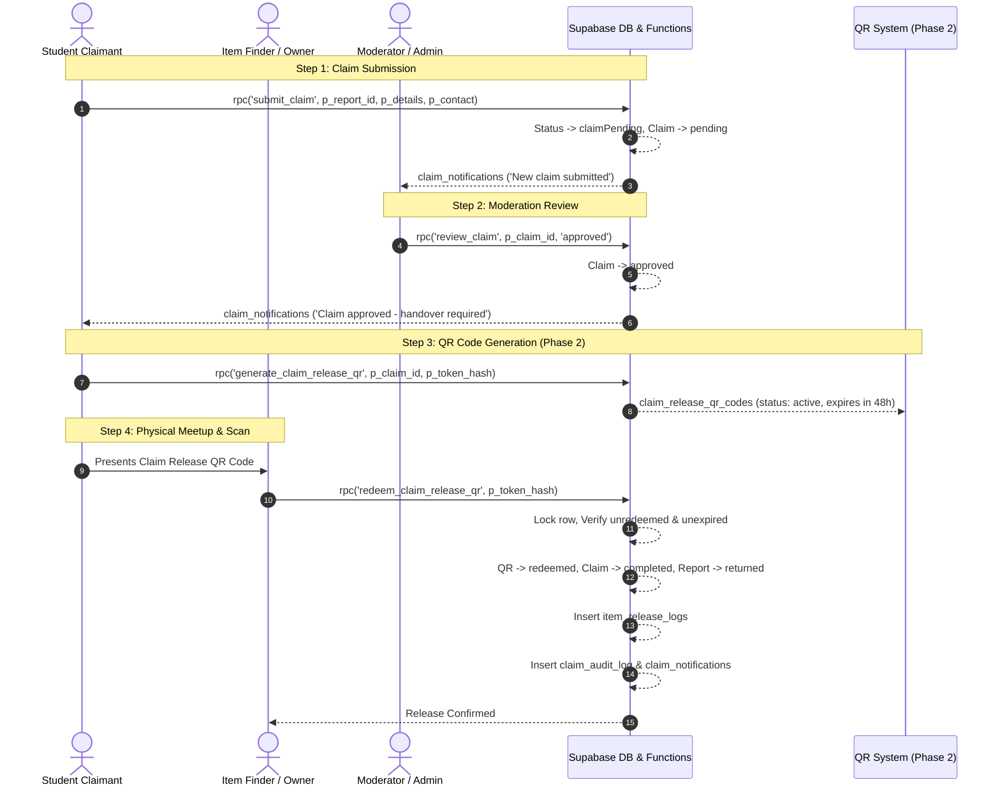

# MarSU Lost & Found – QR Code System Architecture Inspection (Phase 1)

> **Document Version**: 1.0.0  
> **Date**: November 24, 2026  
> **Inspection Scope**: MarSU Lost & Found Application (Flutter Client, Supabase Backend, Existing Schemas, RLS, Storage)  
> **Rule Compliance**: Inspection and architectural analysis only. No remote Supabase operations performed. All existing Flutter features, React Admin Dashboard, and AI Chatbot remain untouched.

---

## 1. Executive Summary

This inspection report evaluates the existing codebase and database infrastructure of the **MarSU Lost & Found** system to establish a robust, tamper-proof foundation for the **QR Code System (Phase 1 & Phase 2)**.

The system requires two distinct QR functionalities:
1. **Item Identification QR**: A persistent identifier linked to eligible item reports (primarily found items, and lost items where tagged), allowing on-campus physical tag discovery and rapid lookup.
2. **Claim Verification QR**: A time-limited, single-use, cryptographically secure digital voucher generated upon claim approval, presented by the claimant during physical item handover to prevent fraudulent or duplicate item claims.

### Key Inspection Findings:
- **Flutter Framework & Architecture**: Built with Flutter (Dart `^3.13.4`) using Material 3 and Provider (`AppState`). Supabase client (`supabase_flutter: ^2.18.3`) is the sole data backend.
- **User Authentication & RBAC**: Handled via Supabase GoTrue (`auth.users`) paired with `public.user_roles` (`student`, `moderator`, `admin`) and `public.user_profiles` (verified name).
- **Claim Lifecycle**: Highly structured server-side state machine governed by PostgreSQL RPCs (`submit_claim`, `review_claim`, `confirm_claim_handover`). Direct client INSERT is revoked on `item_claims`.
- **Integration Feasibility**: Both Item Identification QR and Claim Verification QR can be integrated without modifying existing table columns, altering existing RLS policies, or breaking the current manual handover fallback.

---

## 2. Existing Architecture Overview

---

## 3. Prioritized Existing Tables Inspection

### 3.1 `public.item_reports`
- **Definition Source**: `supabase_schema.sql`
- **Purpose**: Core entity representing lost and found item reports filed by campus students, faculty, or staff.
- **Schema**:
  | Column Name | Data Type | Constraints / Defaults | Description |
  |---|---|---|---|
  | `id` | `uuid` | PK, `default gen_random_uuid()` | Unique report identifier |
  | `owner_id` | `uuid` | NOT NULL, FK -> `auth.users(id)` ON DELETE CASCADE | Reporter user ID |
  | `owner_name` | `text` | NOT NULL | Reporter full name |
  | `report_type` | `text` | NOT NULL, `CHECK (report_type IN ('lost', 'found'))` | Distinguishes lost vs. found |
  | `item_name` | `text` | NOT NULL | Title of reported item |
  | `category` | `text` | NOT NULL | Item category (e.g., ID cards, electronics) |
  | `description` | `text` | NOT NULL | Item details and physical appearance |
  | `incident_date` | `timestamptz` | NOT NULL | Date lost/found |
  | `general_location` | `text` | NOT NULL | Campus location |
  | `image_path` | `text` | NULLABLE | Relative path in `lost-found-images` bucket |
  | `status` | `text` | NOT NULL, default `'open'`, `CHECK (status IN ('open', 'claimPending', 'returned', 'closed'))` | Current lifecycle state |
  | `created_at` | `timestamptz` | NOT NULL, default `now()` | Submission timestamp |
  | `is_flagged` | `boolean` | NOT NULL, default `false` | Moderation flag |
- **RLS Policies**:
  - `Authenticated users can view reports`: SELECT to `authenticated` using `true`.
  - `Users can create their own reports`: INSERT to `authenticated` with check `auth.uid() = owner_id`.
  - `Users can update their own reports`: UPDATE to `authenticated` using `auth.uid() = owner_id`.
  - `Admins can moderate reports`: UPDATE to `authenticated` using `public.has_role('admin')`.
- **Integration Touchpoint**:
  - Item Identification QR records (`item_qr_codes`) will reference `item_reports(id)` with ON DELETE CASCADE.
  - Claim verification redemption will transition `status` from `'claimPending'` or `'open'` to `'returned'` atomically.

---

### 3.2 `public.item_claims`
- **Definition Source**: `supabase_claim_rls_fix.sql` & `supabase_claim_workflow_migration.sql`
- **Purpose**: Tracks ownership claims made by students against found items.
- **Schema**:
  | Column Name | Data Type | Constraints / Defaults | Description |
  |---|---|---|---|
  | `id` | `uuid` | PK, `default gen_random_uuid()` | Unique claim identifier |
  | `item_report_id` | `uuid` | NOT NULL, FK -> `item_reports(id)` ON DELETE CASCADE | Referenced item |
  | `report_id` | `uuid` | NOT NULL, FK -> `item_reports(id)` ON DELETE CASCADE | Synced with `item_report_id` |
  | `claimant_id` | `uuid` | NOT NULL, FK -> `auth.users(id)` ON DELETE CASCADE | Claiming student ID |
  | `claimant_name` | `text` | NOT NULL | Claimant display name |
  | `claimant_contact` | `text` | NOT NULL, default `''` | Contact number |
  | `claimant_contact_hidden`| `boolean` | NOT NULL, default `true` | Privacy toggle |
  | `private_claim_details` | `text` | NOT NULL, default `''` | Proof of ownership |
  | `claim_message` | `text` | NULLABLE | Optional message |
  | `status` | `text` | NOT NULL, default `'pending'`, `CHECK (status IN ('pending', 'approved', 'rejected', 'completed'))` | Claim state |
  | `created_at` | `timestamptz` | NOT NULL, default `now()` | Submission time |
  | `updated_at` | `timestamptz` | NOT NULL, default `now()` | Last update time |
  | `reviewed_by` | `uuid` | NULLABLE, FK -> `auth.users(id)` | Reviewing admin/mod |
  | `reviewed_at` | `timestamptz` | NULLABLE | Decision timestamp |
  | `rejection_reason` | `text` | NULLABLE | Mandatory if rejected |
  | `completed_at` | `timestamptz` | NULLABLE | Handover completion time |
  | `handover_confirmed_by`| `uuid` | NULLABLE, FK -> `auth.users(id)` | Actor confirming handover |
- **Security Invariant**: Direct client INSERT on `item_claims` is completely revoked. Claims MUST be submitted via RPC `submit_claim` and reviewed via RPC `review_claim`.
- **Existing Indexes**:
  - `one_pending_claim_per_claimant` on `(report_id, claimant_id)` where `status = 'pending'`.
  - `active_claims_per_claimant` on `(report_id, claimant_id)` where `status IN ('pending', 'approved')`.
- **Integration Touchpoint**:
  - Claim Verification QR records (`claim_release_qr_codes`) reference `item_claims(id)`.
  - An approved claim (`status = 'approved'`) qualifies for QR release generation.
  - QR redemption updates `status` to `'completed'`, `completed_at = now()`, and `handover_confirmed_by = scanner_id`.

---

### 3.3 `public.user_profiles`
- **Definition Source**: `supabase_user_profiles_migration.sql`
- **Verified Name**: Confirmed as **`user_profiles`** (not `usr_profiles`).
- **Schema**:
  | Column Name | Data Type | Constraints / Defaults | Description |
  |---|---|---|---|
  | `id` | `uuid` | PK, FK -> `auth.users(id)` ON DELETE CASCADE | User ID |
  | `full_name` | `text` | NOT NULL, default `''` | Student/Staff Name |
  | `student_number` | `text` | NOT NULL, default `''` | Campus ID / Student No. |
  | `email` | `text` | NOT NULL, default `''` | Campus Email |
  | `college` | `text` | NOT NULL, default `''` | Academic College |
  | `course` | `text` | NOT NULL, default `''` | Degree Program |
  | `year_level` | `text` | NOT NULL, default `''` | Academic Year |
  | `contact_number` | `text` | NOT NULL, default `''` | Mobile Number |
  | `created_at` | `timestamptz` | NOT NULL, default `now()` | Profile creation time |
  | `updated_at` | `timestamptz` | NOT NULL, default `now()` | Last profile update |
- **Unique Constraint**: `user_profiles_student_number_unique` on `LOWER(TRIM(student_number))` where `TRIM(student_number) <> ''`.
- **Triggers**:
  - `user_profiles_prevent_student_number_change`: Prevents mutating student number once set.
  - `on_auth_user_created_profile`: Creates profile row on user signup.
- **RLS**: Users can only select, insert, and update their own record (`id = auth.uid()`).
- **Integration Touchpoint**: Provides claimant and reporter identity during item QR scanning and handover verification.

---

### 3.4 `public.user_roles`
- **Definition Source**: `supabase_rbac_migration.sql`
- **Schema**:
  | Column Name | Data Type | Constraints / Defaults | Description |
  |---|---|---|---|
  | `user_id` | `uuid` | PK, FK -> `auth.users(id)` ON DELETE CASCADE | Target User |
  | `role` | `text` | NOT NULL, default `'student'`, `CHECK (role IN ('student', 'moderator', 'admin'))` | System Role |
  | `created_at` | `timestamptz` | NOT NULL, default `now()` | Role creation date |
- **Security Functions**:
  - `public.current_user_role() RETURNS text`: Returns role of `auth.uid()` or `'student'`.
  - `public.has_role(required_role text) RETURNS boolean`: Helper used in RLS policies.
- **Integration Touchpoint**:
  - Administrators and moderators have privileged authority to verify and redeem Claim Verification QR codes across campus stations.
  - Item finders (regular students) can only redeem release QR codes for their own found item reports.

---

### 3.5 `public.claim_audit_log`
- **Definition Source**: `supabase_claim_workflow_migration.sql`
- **Schema**:
  | Column Name | Data Type | Constraints / Defaults | Description |
  |---|---|---|---|
  | `id` | `uuid` | PK, `default gen_random_uuid()` | Audit Entry ID |
  | `claim_id` | `uuid` | NOT NULL, FK -> `item_claims(id)` ON DELETE CASCADE | Associated Claim |
  | `actor_id` | `uuid` | NOT NULL, FK -> `auth.users(id)` | User performing action |
  | `action` | `text` | NOT NULL, `CHECK (action IN ('submitted', 'approved', 'rejected', 'handover_confirmed', 'completed'))` | Lifecycle event |
  | `previous_status` | `text` | NULLABLE | Pre-transition status |
  | `new_status` | `text` | NOT NULL | Post-transition status |
  | `created_at` | `timestamptz` | NOT NULL, default `now()` | Log timestamp |
- **RLS**: Restricted to administrators (`public.has_role('admin')`).
- **Integration Touchpoint**:
  - When a Claim Verification QR is redeemed, audit entries with `action = 'handover_confirmed'` and `action = 'completed'` will be created to maintain seamless compatibility with the existing check constraint and admin views.

---

### 3.6 `public.claim_notifications`
- **Definition Source**: `supabase_claim_workflow_migration.sql`
- **Schema**:
  | Column Name | Data Type | Constraints / Defaults | Description |
  |---|---|---|---|
  | `id` | `uuid` | PK, `default gen_random_uuid()` | Notification ID |
  | `recipient_id` | `uuid` | NOT NULL, FK -> `auth.users(id)` ON DELETE CASCADE | Receiving User |
  | `claim_id` | `uuid` | NULLABLE, FK -> `item_claims(id)` ON DELETE CASCADE | Claim reference |
  | `notification_type` | `text` | NOT NULL | Category of notification |
  | `title` | `text` | NOT NULL | Notification headline |
  | `body` | `text` | NOT NULL | Detailed text |
  | `created_at` | `timestamptz` | NOT NULL, default `now()` | Timestamp |
  | `read_at` | `timestamptz` | NULLABLE | Read receipt |
- **RLS**: Users can only SELECT their own notifications (`recipient_id = auth.uid()`).
- **Integration Touchpoint**:
  - Stored redemption functions will automatically insert notifications for both the claimant (item received) and the finder (item released).

---

## 4. Item Reporting & Image Upload Analysis

- **Submission Screen**: `lib/screens/report/report_item_screen.dart`
- **Upload Mechanism**: Uses `ImagePicker().pickImage()`. Validates JPEG format and file size `<= 5MB`.
- **Storage Bucket**: Uploads binary data to private bucket `lost-found-images` under folder `${userId}/${uuid}_${fileName}` via `AppState.uploadImage()`.
- **Access Control**: Bucket is private. Client retrieves access via Supabase SDK `createSignedUrl(imagePath, 3600)`.
- **Database Entry**: Inserts into `public.item_reports` with `image_path` storing the storage object path.
- **QR Integration Opportunity**:
  - When an item report is created, an Item Identification QR code can be generated automatically or on-demand without interfering with the image upload or storage path.

---

## 5. Claiming & Handover Approval Workflow Analysis

### Current Handover vs. QR Handover:
- **Current Flow**: The item finder navigates to `ItemDetailsScreen` and presses "Confirm Handover", calling `confirm_claim_handover(claim_id)`. There is no cryptographic verification that the person standing in front of them is the actual approved claimant.
- **QR Handover Flow**:
  - The claimant holds a temporary verification QR code on their device.
  - The finder or campus administrator scans the QR code.
  - The database atomically validates the cryptographic token hash, locks the records, marks the QR as redeemed, logs the release, and finalizes the claim.
  - **Zero Regression**: The existing `confirm_claim_handover` remains available as a manual fallback if physical scanning is temporarily unavailable.

---

## 6. Potential Conflicts & Security Vulnerabilities

| Potential Conflict / Risk | Severity | Mitigation Strategy |
|---|---|---|
| **Raw Token Leakage**: Storing plaintext verification tokens in the database exposes QR codes to compromise if database reads or logs are leaked. | High | **Strict Token Hashing**: Store ONLY SHA-256 token hashes (`token_hash text NOT NULL UNIQUE`). The client or app holds the ephemeral raw token. |
| **Race Conditions / Double Redemption**: Multiple scans or network retries redeeming the same QR code concurrently. | High | **Atomic Transaction with `FOR UPDATE`**: Stored procedure `redeem_claim_release_qr` locks the QR row and checks `is_redeemed = false` before committing state transitions. |
| **Self-Redemption Fraud**: A claimant scanning their own QR code to falsely mark an item as received without meeting the finder. | High | **Authorization Guard**: The stored procedure rejects redemption if `auth.uid() = claimant_id` (unless the claimant is also an authorized campus admin/moderator). |
| **Expired QR Usage**: Using an old QR screenshot days after expiration. | Medium | **Strict Expiration Check**: QR records contain `expires_at timestamptz`. Redemptions past `expires_at` are rejected with `status = 'expired'`. |
| **Duplicate Active QR Codes**: Generating multiple concurrent active QR codes for the same report or claim. | Medium | **Partial Unique Indexes**: Enforce one active QR code per report (`unique_active_item_qr_per_report`) and one active release QR per claim (`unique_active_claim_release_qr`). |
| **Breaking Existing RLS Policies**: Adding or altering policies on existing core tables. | Low | **Additive Architecture**: Keep existing tables, functions, and RLS policies untouched. Deploy all QR logic in dedicated tables and non-destructive helper functions. |

---

## 7. Recommendations for Phase 2 Implementation

1. **Table Design**:
   - `public.item_qr_codes`: Persistent item identification codes linked to `item_reports`.
   - `public.claim_release_qr_codes`: Ephemeral, single-use claim release vouchers linked to `item_claims`.
   - `public.item_release_logs`: Comprehensive audit log recording who released which item to whom, where, and when.
2. **Token Security**:
   - Store exclusively `token_hash` (64-character SHA-256 hex string).
   - Enforce cryptographic integrity in all RPC signatures.
3. **Automated Cleanup / Revocation**:
   - Re-generating a QR code automatically invalidates/revokes previous active tokens for that claim.
4. **Non-Destructive Migration**:
   - Keep migrations strictly additive.
   - Deploy via timestamped migration file: `supabase/migrations/20261124150000_qr_code_system.sql` and root mirror `supabase_qr_code_system_migration.sql`.
5. **Phase Gate**:
   - Conclude Phase 2 at database preparation. Wait for user review and approval before touching any UI, scanner widgets, or Edge Functions.
