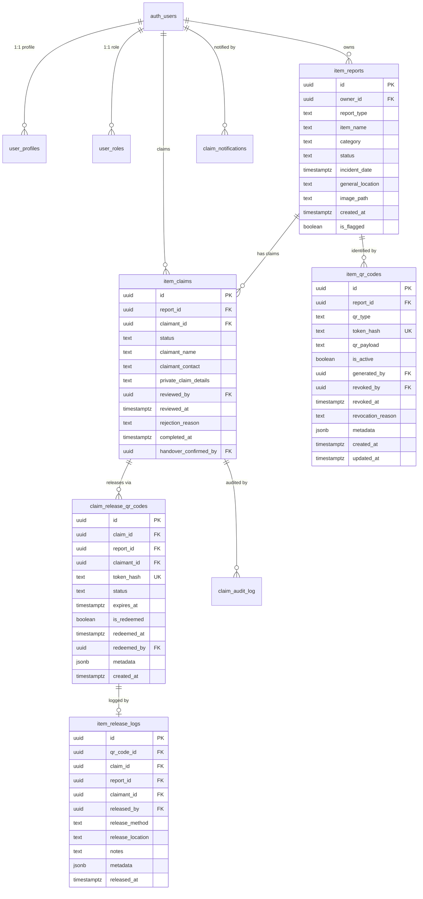
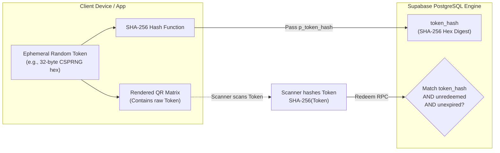

# MarSU Lost & Found – QR Code System Database Implementation (Phase 2)

> **Document Version**: 1.0.0  
> **Date**: November 24, 2026  
> **Target System**: Supabase PostgreSQL 17 Backend  
> **Status**: DATABASE MIGRATION SCRIPT PREPARED LOCALLY (AWAITING REMOTE DEPLOYMENT APPROVAL)  
> **Rule Compliance**: All database artifacts are prepared locally. No changes have been applied to the remote Supabase project without explicit user authorization.

---

## 1. Executive Summary

Phase 2 establishes the database foundation for the **QR Code System** within the MarSU Lost & Found platform. It introduces support for two core operational modes:

1. **Item Identification QR (`public.item_qr_codes`)**:
   - Automatically or on-demand attached to eligible item reports.
   - Long-lived and permanent while active.
   - Supports explicit revocation and regeneration.
2. **Claim Verification QR (`public.claim_release_qr_codes`)**:
   - Generated exclusively for approved claims (`status = 'approved'`).
   - Short-lived with auto-expiration (default: 48 hours).
   - Single-use digital release voucher redeemed atomically at physical item handover.
3. **Item Release Audit Trail (`public.item_release_logs`)**:
   - Immutable audit log capturing physical handovers, tracking the actor who confirmed release, claimant, station location, and timestamps.

### Core Security Principles:
- **Zero Raw Token Persistence**: Raw verification tokens are generated ephemerally on the client or mobile device and are **never stored in the database**. The database stores only the cryptographically secure SHA-256 digest (`token_hash text NOT NULL UNIQUE`).
- **Atomic Concurrency Protection**: QR redemption utilizes PostgreSQL row-level locks (`SELECT ... FOR UPDATE`) to prevent race conditions and duplicate claim redemption attempts.
- **Strict Role-Based Access Control**: Direct client `INSERT`, `UPDATE`, and `DELETE` permissions are revoked on all three tables. All state mutations occur exclusively through authenticated `SECURITY DEFINER` stored procedures.

---

## 2. Entity-Relationship Architecture



---

## 3. Database Table Specifications

### 3.1 Table: `public.item_qr_codes`
Tracks persistent identification QR codes for item reports (e.g., printed physical tags or digital barcodes).

| Column Name | Data Type | Constraints / Defaults | Description |
|---|---|---|---|
| `id` | `uuid` | PK, `default gen_random_uuid()` | Primary key |
| `report_id` | `uuid` | NOT NULL, FK -> `item_reports(id)` ON DELETE CASCADE | Target item report |
| `qr_type` | `text` | NOT NULL, default `'item_tag'`, `CHECK (qr_type IN ('item_tag', 'item_id'))` | QR code subtype |
| `token_hash` | `text` | NOT NULL UNIQUE | Cryptographic SHA-256 hash |
| `qr_payload` | `text` | NOT NULL | Deep-link URI or lookup payload (e.g., `marsu://item/<id>`) |
| `is_active` | `boolean` | NOT NULL, default `true` | Active status toggle |
| `generated_by` | `uuid` | NULLABLE, FK -> `auth.users(id)` ON DELETE SET NULL | User who initiated generation |
| `revoked_by` | `uuid` | NULLABLE, FK -> `auth.users(id)` ON DELETE SET NULL | User who revoked code |
| `revoked_at` | `timestamptz` | NULLABLE | Revocation timestamp |
| `revocation_reason` | `text` | NULLABLE | Reason code / note |
| `metadata` | `jsonb` | NOT NULL, default `'{}'::jsonb` | Extensible metadata |
| `created_at` | `timestamptz` | NOT NULL, default `now()` | Creation time |
| `updated_at` | `timestamptz` | NOT NULL, default `now()` | Last modification time |

- **Indexes**:
  - `item_qr_codes_report_id_idx` on `(report_id)`
  - `item_qr_codes_token_hash_idx` on `(token_hash)`
  - Partial unique index: `unique_active_item_qr_per_report` on `(report_id) WHERE (is_active = true)`
- **Row Level Security**:
  - SELECT granted to `authenticated` users when `is_active = true`, or if the user is the item owner, moderator, or administrator.
  - Client INSERT / UPDATE / DELETE is revoked; only security definer functions can mutate rows.

---

### 3.2 Table: `public.claim_release_qr_codes`
Stores ephemeral, single-use claim verification QR codes for physical handover.

| Column Name | Data Type | Constraints / Defaults | Description |
|---|---|---|---|
| `id` | `uuid` | PK, `default gen_random_uuid()` | Primary key |
| `claim_id` | `uuid` | NOT NULL, FK -> `item_claims(id)` ON DELETE CASCADE | Approved claim reference |
| `report_id` | `uuid` | NOT NULL, FK -> `item_reports(id)` ON DELETE CASCADE | Item report reference |
| `claimant_id` | `uuid` | NOT NULL, FK -> `auth.users(id)` ON DELETE CASCADE | Approved claimant ID |
| `token_hash` | `text` | NOT NULL UNIQUE | SHA-256 digest of secret token |
| `status` | `text` | NOT NULL, default `'active'`, `CHECK (status IN ('active', 'redeemed', 'expired', 'revoked'))` | Voucher lifecycle |
| `expires_at` | `timestamptz` | NOT NULL | Automatic expiration deadline |
| `is_redeemed` | `boolean` | NOT NULL, default `false` | Quick check for redemption |
| `redeemed_at` | `timestamptz` | NULLABLE | Exact timestamp of redemption |
| `redeemed_by` | `uuid` | NULLABLE, FK -> `auth.users(id)` ON DELETE SET NULL | Scanner who confirmed release |
| `metadata` | `jsonb` | NOT NULL, default `'{}'::jsonb` | Additional diagnostic payload |
| `created_at` | `timestamptz` | NOT NULL, default `now()` | Generation timestamp |

- **Integrity Constraint**:
  - `claim_release_qr_redemption_state_check`:
    ```sql
    CHECK (
      (is_redeemed = true AND status = 'redeemed' AND redeemed_at IS NOT NULL)
      OR (is_redeemed = false AND status <> 'redeemed')
    )
    ```
- **Indexes**:
  - `claim_release_qr_claim_id_idx` on `(claim_id)`
  - `claim_release_qr_report_id_idx` on `(report_id)`
  - `claim_release_qr_claimant_id_idx` on `(claimant_id)`
  - `claim_release_qr_token_hash_idx` on `(token_hash)`
  - `claim_release_qr_expires_at_idx` on `(expires_at)`
  - Partial unique index: `unique_active_claim_release_qr` on `(claim_id) WHERE (status = 'active')`
- **Row Level Security**:
  - SELECT permitted for:
    1. The approved claimant (`claimant_id = auth.uid()`).
    2. The item report owner (`owner_id = auth.uid()`).
    3. Campus staff (`has_role('moderator') OR has_role('admin')`).
  - Direct INSERT / UPDATE / DELETE is revoked from all clients.

---

### 3.3 Table: `public.item_release_logs`
Provides an immutable campus audit trail for physical property handovers.

| Column Name | Data Type | Constraints / Defaults | Description |
|---|---|---|---|
| `id` | `uuid` | PK, `default gen_random_uuid()` | Primary log ID |
| `qr_code_id` | `uuid` | NULLABLE, FK -> `claim_release_qr_codes(id)` ON DELETE SET NULL | Redeemed QR reference |
| `claim_id` | `uuid` | NOT NULL, FK -> `item_claims(id)` ON DELETE CASCADE | Associated claim |
| `report_id` | `uuid` | NOT NULL, FK -> `item_reports(id)` ON DELETE CASCADE | Associated report |
| `claimant_id` | `uuid` | NOT NULL, FK -> `auth.users(id)` ON DELETE CASCADE | Receiving student |
| `released_by` | `uuid` | NOT NULL, FK -> `auth.users(id)` ON DELETE CASCADE | Actor who released item |
| `release_method`| `text` | NOT NULL, default `'qr_scan'`, `CHECK (release_method IN ('qr_scan', 'manual_confirmation', 'admin_override'))` | Release channel |
| `release_location`| `text`| NULLABLE | Campus station / building |
| `notes` | `text` | NULLABLE | Handover notes |
| `metadata` | `jsonb` | NOT NULL, default `'{}'::jsonb` | Contextual metadata |
| `released_at` | `timestamptz` | NOT NULL, default `now()` | Immutable timestamp |

- **Indexes**:
  - `item_release_logs_claim_id_idx` on `(claim_id)`
  - `item_release_logs_report_id_idx` on `(report_id)`
  - `item_release_logs_claimant_id_idx` on `(claimant_id)`
  - `item_release_logs_released_by_idx` on `(released_by)`
  - `item_release_logs_released_at_idx` on `(released_at desc)`
- **Row Level Security**:
  - SELECT permitted for the claimant, releasing actor, item owner, moderators, and administrators.
  - INSERT / UPDATE / DELETE revoked from client SDKs.

---

## 4. Cryptographic Token Hashing Strategy



### Why Raw Tokens Are Never Stored:
1. **Zero Eavesdropping Threat**: If an unauthorized party intercepts database backups, query logs, or read-only replicas, they cannot forge QR codes or redeem claims because the raw secret is never present.
2. **One-Way Cryptographic Proof**: Verification matches `token_hash = sha256(scanned_raw_token)`. Without physical access to the displayed QR code on the claimant's screen, the release cannot be triggered.

---

## 5. Stored Procedures & Atomic Functions

### 5.1 `public.generate_item_qr`
```sql
generate_item_qr(
  p_report_id uuid,
  p_token_hash text,
  p_qr_payload text,
  p_metadata jsonb default '{}'::jsonb
) RETURNS public.item_qr_codes
```
- **Access**: `authenticated`
- **Security**: `SECURITY DEFINER`
- **Behavior**:
  - Validates caller is report owner or campus staff (`admin`/`moderator`).
  - Automatically deactivates and supersedes any existing active QR code for that item report.
  - Inserts new active record into `item_qr_codes`.

---

### 5.2 `public.revoke_item_qr`
```sql
revoke_item_qr(
  p_qr_id uuid,
  p_reason text default 'Revoked by user'
) RETURNS public.item_qr_codes
```
- **Access**: `authenticated`
- **Security**: `SECURITY DEFINER`
- **Behavior**:
  - Validates caller authorization.
  - Updates `is_active = false`, `revoked_at = now()`, `revoked_by = auth.uid()`.

---

### 5.3 `public.generate_claim_release_qr`
```sql
generate_claim_release_qr(
  p_claim_id uuid,
  p_token_hash text,
  p_validity_hours integer default 48,
  p_metadata jsonb default '{}'::jsonb
) RETURNS public.claim_release_qr_codes
```
- **Access**: `authenticated`
- **Security**: `SECURITY DEFINER`
- **Behavior**:
  - Validates claim is strictly in `'approved'` status.
  - Validates caller is the approved claimant or authorized campus staff.
  - Revokes any previously issued active release QR code for the claim.
  - Calculates expiration timestamp (`now() + validity_hours`).
  - Inserts row into `claim_release_qr_codes`.

---

### 5.4 `public.verify_claim_release_qr_preview`
```sql
verify_claim_release_qr_preview(
  p_token_hash text
) RETURNS json
```
- **Access**: `authenticated`
- **Security**: `SECURITY DEFINER`
- **Behavior**:
  - Scans and matches `token_hash`.
  - Authorizes only the finder (report owner) or campus staff to preview details.
  - Returns non-destructive preview JSON containing item name, claimant name, student ID, and validity status.
  - Allows the scanner to visually inspect and confirm belonging details **before** completing redemption.

---

### 5.5 `public.redeem_claim_release_qr` (Atomic Redemption)
```sql
redeem_claim_release_qr(
  p_token_hash text,
  p_release_location text default null,
  p_notes text default null
) RETURNS json
```
- **Access**: `authenticated`
- **Security**: `SECURITY DEFINER`
- **Atomic Operations** (Executed in a single database transaction):
  1. `SELECT * FROM claim_release_qr_codes WHERE token_hash = p_token_hash FOR UPDATE`: Row-level exclusive lock.
  2. Asserts `is_redeemed = false`, `status = 'active'`, and `expires_at >= now()`.
  3. `SELECT * FROM item_claims WHERE id = qr.claim_id FOR UPDATE`: Asserts `status = 'approved'`.
  4. `SELECT * FROM item_reports WHERE id = qr.report_id FOR UPDATE`: Asserts status is not already `'returned'` or `'closed'`.
  5. **Anti-Fraud Guard**: Rejects redemption if `caller_id = claimant_id` (claimants cannot self-redeem). Only finder or staff can verify release.
  6. Updates `claim_release_qr_codes`: `is_redeemed = true`, `status = 'redeemed'`, `redeemed_at = now()`, `redeemed_by = caller_id`.
  7. Updates `item_claims`: `status = 'completed'`, `completed_at = now()`, `handover_confirmed_by = caller_id`.
  8. Updates `item_reports`: `status = 'returned'`.
  9. Inserts record into `item_release_logs`.
  10. Inserts two entries into `claim_audit_log` (`'handover_confirmed'` and `'completed'`).
  11. Inserts notifications into `claim_notifications` for both claimant and report owner.
  12. Returns JSON receipt with log and redemption identifiers.

---

## 6. Migration File Details

The migration has been created in two standardized locations:
1. **Supabase CLI Standard Migration**:
   - Path: `supabase/migrations/20261124150000_qr_code_system.sql`
2. **Root SQL Mirror (for Supabase Web Dashboard SQL Editor)**:
   - Path: `supabase_qr_code_system_migration.sql`

Both files contain identical, idempotent, and non-destructive DDL statements using `IF NOT EXISTS` guards.

---

## 7. Deployment Instructions

### ⚠️ IMPORTANT: Remote Deployment Requires User Approval
In compliance with project instructions, no remote SQL has been executed. Follow these deployment instructions when ready:

#### Option A: Via Supabase CLI (Recommended if linked)
```powershell
# Navigate to the workspace
cd D:\FlutterProjects\marsu_lost_and_found

# Review migration diff
supabase db diff

# Push migration to remote Supabase project
supabase db push
```

#### Option B: Via Supabase Web Dashboard SQL Editor
1. Log in to your [Supabase Dashboard](https://supabase.com/dashboard/project/eeedchsnxqyibprjkpdu).
2. Navigate to **SQL Editor** in the left sidebar.
3. Open `supabase_qr_code_system_migration.sql` from your project root.
4. Copy and paste the full script into a new query window.
5. Click **Run**.
6. Check the **Results** pane to ensure all tables, indexes, RLS policies, and functions were created without errors.
7. PostgREST will automatically reload the schema cache.

---

## 8. Verification & Rollback Strategy

### Verification Query:
Run this query in Supabase SQL Editor after deployment to verify table creation:
```sql
select table_name 
from information_schema.tables 
where table_schema = 'public' 
  and table_name in ('item_qr_codes', 'claim_release_qr_codes', 'item_release_logs');
```

Expected result: 3 rows returned.

### Non-Destructive Rollback (If ever required):
Because this migration is completely additive, reverting it does not affect any existing data in `item_reports`, `item_claims`, `user_roles`, or `user_profiles`:
```sql
-- Safe teardown script (ONLY run if rolling back Phase 2)
drop function if exists public.redeem_claim_release_qr(text, text, text);
drop function if exists public.verify_claim_release_qr_preview(text);
drop function if exists public.generate_claim_release_qr(uuid, text, integer, jsonb);
drop function if exists public.revoke_item_qr(uuid, text);
drop function if exists public.generate_item_qr(uuid, text, text, jsonb);

drop table if exists public.item_release_logs;
drop table if exists public.claim_release_qr_codes;
drop table if exists public.item_qr_codes;
```
