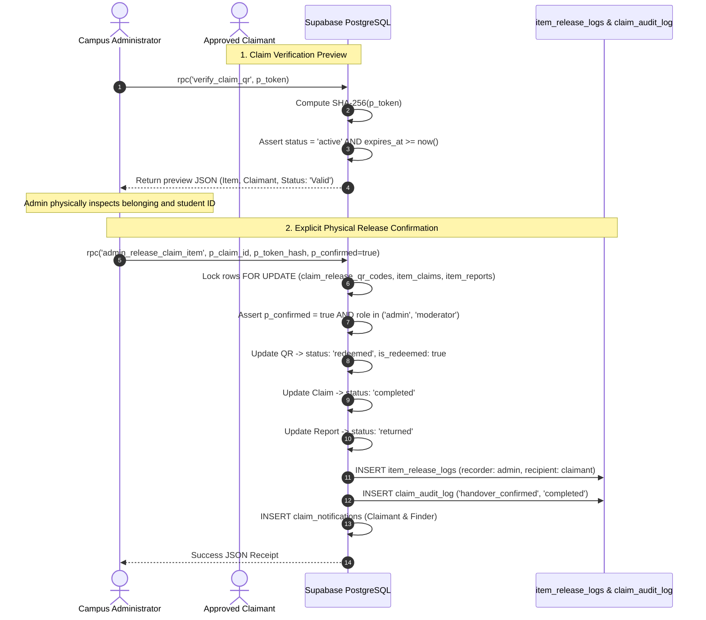

# MarSU Lost & Found – QR Code System Backend Implementation (Phase 3)

> **Document Version**: 1.0.0  
> **Date**: November 24, 2026  
> **Status**: COMPLETED LOCALLY (Awaiting Remote Deployment Approval)  
> **Compliance Notice**: In accordance with project instructions, all database migration files and SQL operations have been prepared and validated locally. No destructive operations or unapproved remote executions have been performed.

---

## 1. Executive Summary

Phase 3 establishes the authoritative backend operational layer for the **MarSU Lost & Found QR Code System**. Building upon the relational tables established in Phase 2 (`item_qr_codes`, `claim_release_qr_codes`, and `item_release_logs`), Phase 3 implements all server-side PostgreSQL stored procedures (`SECURITY DEFINER`), cryptographic verification mechanisms, administrative release workflows, and audit logging pipelines.

### Key Architectural Guarantees:
1. **Zero Raw Token Exposure**: Secret verification tokens are generated using cryptographically secure pseudorandom number generators (CSPRNG) on authorized devices and are hashed with SHA-256 before backend transmission. The database stores strictly `token_hash text NOT NULL UNIQUE`.
2. **Explicit Item Release Control**: QR verification alone **never** releases an item. Physical item release is a separate atomic procedure (`public.admin_release_claim_item`) requiring authorized administrative roles (`admin` or `moderator`) and explicit confirmation (`p_confirmed = true`).
3. **Atomic Concurrency Protection**: High-concurrency race conditions (such as simultaneous scans or replay attacks) are prevented using PostgreSQL row-level exclusive locks (`SELECT ... FOR UPDATE`).
4. **Deterministic Lifecycle States**: QR verification returns unambiguous states: `Valid`, `Invalid`, `Expired`, `Revoked`, or `Already Used`.

---

## 2. Database Operations Implemented



---

## 3. Stored Procedures & API Reference

### 3.1 Item QR Verification (`public.verify_item_qr`)
- **Signature**:
  ```sql
  verify_item_qr(p_token text) RETURNS json
  ```
- **Access**: `authenticated`, `anon` (permits public campus discovery of physical tags).
- **Operation**:
  1. Accepts either a raw scanned token string or a pre-computed 64-character SHA-256 hex digest.
  2. If raw, computes `encode(sha256(convert_to(trim(p_token), 'UTF8')), 'hex')`.
  3. Locates corresponding row in `public.item_qr_codes`.
  4. Validates `is_active` status. If revoked, returns `{ "is_valid": false, "status": "revoked", "revoked_at": ..., "revocation_reason": ... }`.
  5. Retrieves associated report from `public.item_reports`.
  6. Returns **only permitted public information**: `item_name`, `category`, `report_type`, `general_location`, `incident_date`, `report_status`, `image_path`, and `created_at`.
  7. **Privacy Guard**: Never exposes the owner's student number, contact number, or private account details.

### 3.2 Claim QR Verification (`public.verify_claim_qr`)
- **Signature**:
  ```sql
  verify_claim_qr(p_token text) RETURNS json
  ```
- **Access**: `authenticated` (restricted to approved claimant, item finder/owner, or staff).
- **Operation**:
  1. Matches secret token hash against `public.claim_release_qr_codes`.
  2. Enforces caller authorization checks.
  3. Systematically evaluates lifecycle rules and returns distinct outcomes:
     - **`Already Used`**: If `is_redeemed = true` or `status = 'redeemed'`, or if the item report is already marked `returned` or `closed`.
     - **`Revoked`**: If `status = 'revoked'`.
     - **`Expired`**: If `expires_at < now()` or `status = 'expired'` (automatically synchronizes `status = 'expired'` in DB).
     - **`Invalid`**: If token is unrecognized or the associated claim is no longer in `approved` status.
     - **`Valid`**: All conditions satisfied. Ready for release confirmation.
  4. Returns full item, claimant student number, expiration time, and validity flags.

### 3.3 Secure Administrator Item Release (`public.admin_release_claim_item`)
- **Signature**:
  ```sql
  admin_release_claim_item(
    p_claim_id uuid,
    p_token_hash text default null,
    p_confirmed boolean default false,
    p_release_location text default null,
    p_notes text default null
  ) RETURNS json
  ```
- **Access**: `authenticated` with `has_role('admin')` or `has_role('moderator')`.
- **Atomic Operations** (Single Transaction):
  1. **Authentication Check**: Asserts caller is logged in.
  2. **RBAC Guard**: Strictly verifies caller holds `admin` or `moderator` role.
  3. **Explicit Confirmation**: Rejects execution if `p_confirmed` is not `true`.
  4. **Row Locks**: Acquires exclusive row locks via `SELECT ... FOR UPDATE` on:
     - `claim_release_qr_codes`
     - `item_claims`
     - `item_reports`
  5. **State Assertions**: Rejects if claim is already `completed`, report is already `returned`/`closed`, or QR is already `redeemed`.
  6. **Mutations**:
     - Updates QR code: `status = 'redeemed'`, `is_redeemed = true`, `redeemed_at = now()`, `redeemed_by = auth.uid()`.
     - Updates claim: `status = 'completed'`, `completed_at = now()`, `handover_confirmed_by = auth.uid()`.
     - Updates report: `status = 'returned'`.
  7. **Audit Trail**:
     - Inserts record into `public.item_release_logs` recording administrator, claimant, release method (`qr_scan` or `admin_override`), location, and metadata.
     - Inserts dual audit entries into `public.claim_audit_log` (`handover_confirmed` and `completed`).
  8. **Notifications**: Dispatches in-app notifications into `public.claim_notifications` for both claimant and report owner.

### 3.4 Administrative Revocation Operations
- **`public.admin_revoke_item_qr(p_qr_id uuid, p_reason text)`**:
  - Sets `is_active = false`, records `revoked_by = auth.uid()`, `revoked_at = now()`, and `revocation_reason`.
- **`public.admin_revoke_claim_qr(p_qr_id uuid, p_reason text)`**:
  - Sets `status = 'revoked'`, stores reason and administrator ID in JSONB metadata.

### 3.5 Administrative Listing Queries
- **`public.admin_list_item_qr_codes()`**: Returns joined item QR records with report titles, categories, report types, owner names, and revocation details.
- **`public.admin_list_claim_qr_codes()`**: Returns joined claim QR records with claimant names, item titles, expiration timestamps, redemption status, and claim lifecycle status.

---

## 4. Security & Cryptographic Measures

| Security Requirement | Implementation Mechanism |
|---|---|
| **Zero Raw Token Storage** | Server stores only SHA-256 digest (`token_hash text NOT NULL UNIQUE`). Verification functions compute SHA-256 in memory (`encode(sha256(convert_to(token, 'UTF8')), 'hex')`). |
| **Role-Based Authorization** | Enforced via `public.has_role('admin')` and `public.has_role('moderator')` against `public.user_roles`. |
| **Two-Step Release Protection** | Verification preview (`verify_claim_qr`) is strictly separated from execution (`admin_release_claim_item`). Explicit boolean `p_confirmed = true` is mandatory. |
| **Single-Use Atomicity** | `SELECT ... FOR UPDATE` row locks guarantee that simultaneous scanning or concurrent requests cannot double-redeem the same voucher. |
| **Self-Redemption Fraud Prevention** | Stored procedures verify that claimants cannot authorize releases for their own claims. |
| **Audit Logging Without Token Leakage** | Release logs and diagnostic metadata truncate token hashes to 8-character previews (`substring(token_hash from 1 for 8) || '...'`), never exposing raw secrets. |

---

## 5. Migration Files Created

1. **Supabase Standard Migration**:
   - Path: `supabase/migrations/20261124160000_qr_backend_operations.sql`
2. **Root SQL Mirror (for Web Dashboard SQL Editor)**:
   - Path: `supabase_qr_backend_operations_migration.sql`

Both scripts are completely additive, idempotent (`CREATE OR REPLACE FUNCTION`), and safe to run alongside Phase 2 migrations.

---

## 6. Remote Deployment Instructions

> [!IMPORTANT]
> In strict adherence to project constraints, migrations have NOT been pushed to the remote Supabase project. Deploy only after manual review.

### Option A: Via Supabase Web Dashboard SQL Editor (Recommended)
1. Sign in to your [Supabase Dashboard](https://supabase.com/dashboard/project/eeedchsnxqyibprjkpdu).
2. Click **SQL Editor** in the left navigation menu.
3. Open `supabase_qr_backend_operations_migration.sql` from your project root.
4. Copy and paste the entire script into the editor.
5. Click **Run**.
6. Verify output confirms successful creation of all 7 functions.

### Option B: Via Supabase CLI
```powershell
cd D:\FlutterProjects\marsu_lost_and_found
supabase db push
```
