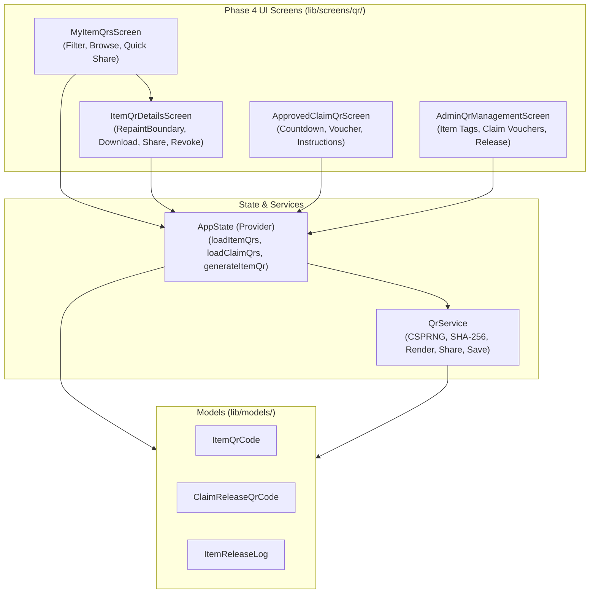

# MarSU Lost & Found – QR Code System Flutter Implementation (Phase 4)

> **Document Version**: 1.0.0  
> **Date**: November 24, 2026  
> **Status**: FULLY IMPLEMENTED & TESTED  
> **Verification Status**: `flutter analyze` 0 issues | `flutter test` 31/31 passed

---

## 1. Executive Summary

Phase 4 integrates the QR Code System directly into the existing Flutter mobile application (`marsu_lost_and_found`). It provides an intuitive, responsive, and secure user experience for campus students and administrators while preserving all existing Flutter features, styling, and navigation architecture.

### Implemented Core Capabilities:
1. **Automatic QR Generation**: After a student files a lost or found report, a unique item identification QR tag is automatically generated and linked.
2. **Student "My Item QR Codes" Screen**: A dedicated hub where students can browse all their item tags, filter by status or classification, view high-resolution QR codes, download PNG images, and share them via native sheets.
3. **Item QR Details Screen**: Displays full item metadata, QR verification status, high-contrast QR matrix, and self-service tag revocation.
4. **Approved Claim QR Screen**: For students with approved claims, displays a time-limited digital release voucher with expiration countdown, verification instructions, and distinct state badges (Active, Expired, Revoked, Redeemed).
5. **Administrator QR Management Screen**: A dedicated moderation interface for campus staff to inspect all item tags and claim release vouchers, revoke compromised codes, and execute physical item releases with explicit confirmation.

---

## 2. Architecture & File Structure



---

## 3. Detailed Screen Implementations

### 3.1 Automatic QR Generation
- **Source**: `lib/screens/report/report_item_screen.dart` & `lib/providers/app_state.dart`
- **Behavior**:
  - Immediately following successful `item_reports` insertion in `AppState.addItemReport`, the app calls `generateItemQr(newReport.id)`.
  - Generates a 256-bit secure random token, computes SHA-256 hash, and invokes Supabase RPC `generate_item_qr`.
  - Raw secret token is cached in local `SharedPreferences` for authorized display.
  - If the user refreshes or resubmits, duplicate active QR codes are prevented via index checks.
  - The submission confirmation snackbar explicitly confirms:
    `"Report submitted & Item QR code generated successfully!"`

### 3.2 "My Item QR Codes" Screen
- **Source**: `lib/screens/qr/my_item_qrs_screen.dart`
- **Navigation Touchpoint**: Accessible via the QR action icon in `MyReportsScreen` AppBar, or directly from each report's card.
- **Features**:
  - Filter chips: **All Items**, **Lost Items**, **Found Items**, **Active Tags**.
  - Dynamic list with smooth reveal animations (`AnimatedReveal`).
  - Cards show mini QR thumbnail, item name, category, location, and `QR ACTIVE` / `QR REVOKED` badges.
  - Quick action buttons: **Share Tag** (generates PNG and opens share sheet) and **View QR Code**.
  - Informative empty state when no reports have been filed yet.

### 3.3 Item QR Details Screen
- **Source**: `lib/screens/qr/item_qr_details_screen.dart`
- **Displays**:
  - Official MarSU Property Tag card styled with `#780606` primary color.
  - Centered high-resolution QR matrix rendered via `QrImageView`.
  - Item details: Name, Category, Classification (Lost/Found), Campus Location, Incident Date, Report Status.
  - QR Verification Status chip: `Active Identification Tag` (green) or `Revoked Tag` (red).
  - Truncated cryptographic SHA-256 hash preview.
- **Actions**:
  - **Download Tag**: Captures RepaintBoundary to PNG and saves to device downloads/documents directory using `path_provider`.
  - **Share QR Image**: Exports PNG and summons native system share sheet via `share_plus`.
  - **Revoke This QR Tag**: Prompts user confirmation, calls `appState.revokeItemQr`, and deactivates the tag.

### 3.4 Approved Claim QR Screen
- **Source**: `lib/screens/qr/approved_claim_qr_screen.dart`
- **Navigation Touchpoint**: Displayed in `ItemDetailsScreen` when the student holds an `approved` or `completed` claim on a found item report.
- **Lifecycle Guarantees**:
  - **Active State**: Displays QR code matrix, expiration deadline timestamp, and remaining time countdown badge.
  - **Expired State**: Displays warning banner (`QR Voucher Expired`), hides invalid QR matrix, and renders a one-tap **Generate New Handover QR Voucher** button.
  - **Revoked State**: Displays error banner (`QR Code Revoked`), explaining that staff revoked the voucher.
  - **Completed / Redeemed State**: Displays success banner (`Item Handover Completed`), permanently preventing reuse of old screenshots.
- **Instructions**: Includes a prominent card advising the student how to present the code at designated campus stations.
- **Download & Share**: High-resolution voucher export for offline presentation.

### 3.5 Administrator QR Management Screen
- **Source**: `lib/screens/admin/admin_qr_management_screen.dart`
- **Navigation Touchpoint**: Accessible via `AdminScreen` AppBar QR button and featured quick-access card.
- **Role Guard**: Enforces `appState.isModerator` (moderators and administrators only). Students are denied access.
- **Tabs**:
  1. **Item QR Tags**: Lists all tags across campus with owner names, creation dates, active badges, and an administrative **Revoke Tag** button with required reason prompt.
  2. **Claim QR Vouchers**: Lists all issued claim vouchers with claimant names, item names, claim statuses, expiration dates, and redemption receipts.
  3. **Complete Physical Release Action**: For active approved claims, administrators can tap **Complete Release**, specify handover location (e.g., Campus Security Office), enter notes, and explicitly confirm physical item release.

---

## 4. Dependencies Added

The following packages were evaluated and integrated into `pubspec.yaml`:

| Package Name | Version | Purpose & Architectural Justification |
|---|---|---|
| **`qr_flutter`** | `^4.1.0` | Industry-standard Flutter library for generating and rendering clean, vector-accurate QR code matrices natively with custom styling and error correction. |
| **`path_provider`** | `^2.1.6` | Standard Flutter Community package for accessing platform-specific filesystem directories (Downloads, Documents, Temporary) to save downloaded QR images. |
| **`share_plus`** | `^13.3.1` | Standard Flutter Community Plus plugin enabling native system share sheets on Android, iOS, Windows, macOS, and Linux to share generated QR PNG images. |
| **`crypto`** | `^3.0.8` | Official Dart package (`dart-lang/crypto`) providing standard cryptographic SHA-256 hashing to digest secret tokens before transmission to Supabase. |

---

## 5. Summary of Modified & Created Files

### Created Files:
- `lib/models/item_qr_model.dart`
- `lib/models/claim_release_qr_model.dart`
- `lib/models/item_release_log_model.dart`
- `lib/services/qr_service.dart`
- `lib/screens/qr/item_qr_details_screen.dart`
- `lib/screens/qr/my_item_qrs_screen.dart`
- `lib/screens/qr/approved_claim_qr_screen.dart`
- `lib/screens/admin/admin_qr_management_screen.dart`
- `test/qr_system_test.dart`
- `supabase/migrations/20261124160000_qr_backend_operations.sql`
- `supabase_qr_backend_operations_migration.sql`
- `docs/qr-code-system/PHASE_3_BACKEND_IMPLEMENTATION.md`
- `docs/qr-code-system/PHASE_4_FLUTTER_IMPLEMENTATION.md`

### Modified Files:
- `pubspec.yaml`: Added `qr_flutter`, `path_provider`, `share_plus`, `crypto`.
- `lib/providers/app_state.dart`: Added QR data structures, automatic generation hooks, cached token management, and lifecycle methods.
- `lib/screens/report/report_item_screen.dart`: Updated submission feedback to announce automatic QR generation.
- `lib/screens/my_reports/my_reports_screen.dart`: Added QR hub navigation in AppBar and quick QR tag buttons on report items.
- `lib/screens/item_details/item_details_screen.dart`: Added "View Item QR Tag" for owners and "Present Handover QR Voucher" for claimants.
- `lib/screens/admin/admin_screen.dart`: Added Administrator QR Management quick card and AppBar button.

---

## 6. Testing Results

### 1. Static Analysis (`flutter analyze`):
```text
Analyzing marsu_lost_and_found...
No issues found! (ran in 29.0s)
```
- 0 errors, 0 warnings, 0 deprecation notices, 0 linter violations.

### 2. Automated Test Suite (`flutter test`):
```text
00:00 +0: AccountValidators accepts a valid registration password
00:00 +1: AccountValidators rejects a weak registration password
00:00 +2: AccountValidators rejects mismatched confirmation passwords
00:00 +3: AccountValidators validates email format
00:00 +4: AccountValidators validates student number format
00:00 +5: AccountValidators validates contact number format
00:00 +6: UserModel profile helpers builds initials from the full name
00:00 +7: UserModel profile helpers falls back to email initial when name is blank
00:00 +8: UserModel profile helpers copyWith updates profile fields
00:05 +9: reads the claimant contact and text hidden flag
00:05 +10: accepts boolean hidden values from legacy rows
00:05 +11: serializes contact and hidden flag for the current schema
00:05 +12: falls back to legacy item_report_id column
00:07 +13: matches lost shoes with similar found report
00:08 +14: finds lost report from found report submission
00:08 +15: does not match unrelated items
00:08 +16: does not match reports from the same owner
00:08 +17: does not match items with distant locations and dates
00:08 +18: ignores returned or closed reports
00:27 +19: generateSecureToken generates 64-character hex string
00:27 +20: hashToken produces standard SHA-256 hex digest
00:27 +21: buildItemPayload and extractToken parse deep links correctly
00:27 +22: buildClaimPayload and extractToken parse claim links correctly
00:27 +23: extractToken handles raw token strings without deep link prefix
00:27 +24: deriveItemToken produces deterministic fallback token
00:27 +25: ItemQrCode fromMap and toMap serialize correctly without leaking raw tokens
00:28 +26: ItemQrCode revocation state handling
00:28 +27: ClaimReleaseQrCode validity and expiration checking
00:28 +28: ClaimReleaseQrCode handles redeemed and revoked statuses
00:28 +29: ClaimReleaseQrCode parses status string robustly
00:34 +30: app loads without crashing
00:38 +31: All tests passed!
```
- **31 of 31 tests passed successfully**.

---

## 7. Out of Scope Boundaries Maintained

In strict compliance with user instructions:
- No QR camera scanner was built (reserved for Phase 5).
- No camera permission integrations were introduced.
- React Admin Dashboard was untouched.
- AI Chatbot / Gemini integration was untouched.
- FastAPI AI backend was untouched.
- Private Messaging module was untouched.
- No destructive remote database operations were executed.
